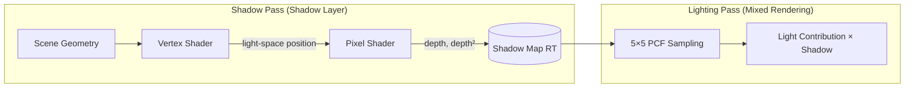

# apEx Shadow Techniques

Shadow mapping in Phoenix follows the same philosophy as the rest of the engine: do the minimum work that produces maximum visual impact, and fit it all inside 64 kilobytes. Where game engines build elaborate shadow systems with cascades, atlases, and per-light shadow maps, Phoenix renders a single orthographic shadow map for the primary light and samples it with hardware-accelerated PCF. One shadow map, one light, 25 texture lookups. That's the entire shadow system.

This simplicity is deliberate. In a choreographed demo, artists control exactly which light casts shadows, how soft those shadows appear, and how the shadow frustum tracks the camera. There's no need for automatic cascade selection or dynamic shadow resolution. The shadow frustum dimensions animate via splines, so artists tighten coverage around the visible scene for maximum texel density. The result looks polished because every parameter is hand-tuned to each moment of the demo.

The codebase reveals an interesting archaeological detail: the shadow sampling function is named `VSM()` in the original HLSL, but it actually implements PCF using `SampleCmpLevelZero`. Meanwhile, the shadow pass outputs depth and depth-squared—the classic Variance Shadow Map moment format. This tells you Conspiracy originally used statistical VSM sampling, then switched to hardware PCF for sharper, more predictable results, but kept the VSM output format and function name. Demo production values pragmatism over consistency.

## Shadow Architecture Overview



Phoenix's render layer system treats shadows like any other multi-pass effect. The Shadow Layer is a render layer with its own render target, configured alongside bloom, DoF, and other effect layers. Shadow-casting materials specify the Shadow Layer as their target, and the engine routes geometry there automatically. No special shadow API needed—it's just another layer.

## Shadow Map Generation

### Shadow Pass Shader

Two shadow pass shaders exist in Clean Slate, both targeting the Shadow Layer render target.

**Basic shadow pass** (`shadow-pass.hlsl`):

```hlsl
VSOUT v(VSIN x)
{
    VSOUT k;

    // Build light-space matrices in the vertex shader
    float4x4 lm = buildLightMatrix(lights[0].spotdirection.xyz, lights[0].pos.xyz);
    float4x4 om = buildOrthoMatrix(lights[0].ambient.w, lights[0].diffuse.w, 0);

    // Transform to world, then to light clip space
    k.p = mul(worldmat, float4(x.Position, 1)).xyz;
    k.Position = mul(om, mul(lm, float4(k.p, 1)));
    k.p = k.Position.xyz / k.Position.w;
    k.uv = x.UV.xy;

    return k;
}

float4 p(VSOUT v) : SV_TARGET0
{
    // Alpha test for foliage / cutout shadows
    float4 tc = t_0.Sample(Sampler, v.uv.xy);
    if (data.y < tc.a) discard;

    // VSM moment output: (depth, depth²)
    return float2(v.p.z, v.p.z * v.p.z).xyxy;
}
```

The vertex shader constructs its own light view and projection matrices rather than receiving them from the constant buffer. This is unusual—game engines typically pass pre-computed shadow matrices through uniforms. Phoenix does it per-vertex because the `LIGHTDATA` structure has no dedicated shadow matrix slots. Light parameters repurpose existing fields:

| Field | Standard Use | Shadow Use |
|-------|-------------|------------|
| `lights[0].pos.xyz` | Light direction | Light look-at direction |
| `lights[0].spotdirection.xyz` | Spot cone axis | Shadow camera eye position |
| `lights[0].ambient.w` | Unused padding | Shadow frustum width |
| `lights[0].diffuse.w` | Unused padding | Shadow frustum height |

This packing trades GPU ALU (matrix construction per vertex) for constant buffer space (no extra shadow matrix uniform), a valid trade in size-constrained 64k intros.

### Light-Space Matrix Construction

```hlsl
float4x4 buildLightMatrix(float3 eye, float3 dir)
{
    float3 z = normalize(dir);
    float3 x = normalize(cross(float3(0,1,0), z));
    float3 y = cross(z, x);

    float4x4 viewmat = float4x4(
        x.x, y.x, z.x, 0,
        x.y, y.y, z.y, 0,
        x.z, y.z, z.z, 0,
        -dot(x,eye), -dot(y,eye), -dot(z,eye), 1);
    return transpose(viewmat);
}

float4x4 buildOrthoMatrix(float w, float h, float r)
{
    float zf = 100;
    float zn = 0;

    float4x4 orthomat = float4x4(
        2/w, 0,   0,          0,
        0,   2/h, 0,          0,
        0,   0,   1/(zn-zf),  0,
        0,   0,  -zn/(zn-zf), 1);
    return transpose(orthomat);
}
```

The orthographic projection uses a fixed far plane at 100 units and near plane at 0. The frustum dimensions (`w`, `h`) come from spline-animated light parameters (`Spline_Light_OrthoX`, `Spline_Light_OrthoY`), letting artists tighten the shadow frustum around the visible scene for maximum shadow map resolution. Since demos are choreographed, the frustum can track the camera perfectly—no need for automatic cascade selection.

The `cross(float3(0,1,0), z)` up-vector assumption means the light can't point straight up or down without the cross product degenerating. This is acceptable for demos where light directions are artist-controlled.

### Shadow Pass with Vertex Displacement

**Shadow pass with UV offset** (`shadow-pass-with-uv-offset.hlsl`) extends the basic pass for geometry that uses texture-driven vertex displacement:

```hlsl
VSOUT v(VSIN x)
{
    VSOUT k;

    float4x4 lm = buildLightMatrix(lights[0].spotdirection.xyz, lights[0].pos.xyz);
    float4x4 om = buildOrthoMatrix(lights[0].ambient.w, lights[0].diffuse.w, 0);

    // Apply the same displacement as the main render pass
    float2 uv2Off = x.UV.zw + data.zw;
    float scaleV = t_1.SampleLevel(Sampler, uv2Off, 0).x;

    float3 uvoffset = scale.xyz;
    k.p = mul(worldmat, float4(
        x.Position + (scaleV * (1 - x.Color.x)) * (uvoffset + normalize(x.Normal) * scale.w),
        1)).xyz;

    k.Position = mul(om, mul(lm, float4(k.p, 1)));
    k.p = k.Position.xyz / k.Position.w;
    k.uv = x.UV.xy;

    return k;
}
```

This exists for a specific visual correctness problem: when the main render pass displaces vertices (wind-blown foliage, animated terrain), the shadow pass must apply the same displacement. Otherwise shadows detach from the visible geometry, creating obvious visual artifacts.

The displacement system works as follows:
- Sample a deformation texture at `UV2 + offset` (the offset is animated via `data.zw`)
- Scale the displacement by `(1 - vertex_color.red)`, using vertex color as a mask (painted by artists to control which vertices move)
- Offset along a specified direction (`scale.xyz`) plus along the surface normal (`scale.w`)

Both the direction and normal scale are animated per-material parameters, enabling effects like grass swaying or surfaces breathing.

### Shadow Map Output Format

Both shadow passes output `float2(depth, depth²).xyxy` to a color render target rather than using a depth-only pass. This is the Variance Shadow Map moment format, which supports:

- **Statistical shadow filtering**: The variance `E[x²] - E[x]²` estimates shadow softness via Chebyshev's inequality
- **Bilinear filterability**: Unlike depth comparison textures, moment textures can be hardware-filtered, enabling smooth shadow boundaries without PCF

However, Clean Slate's lighting shaders don't actually use the VSM statistical path—they sample with `SampleCmpLevelZero`, which performs hardware depth comparison (PCF). The VSM output format is vestigial, suggesting the technique was prototyped but PCF was chosen for production.

## Shadow Sampling

### PCF (Percentage-Closer Filtering)

The PBR mixed-rendering shaders consume the shadow map with a 5×5 PCF kernel:

```hlsl
float VSM(float2 TexBase, float LightCompare, float shdw)
{
    float shadow = 0;
    for (int x = 0; x < 5; x++)
        for (int y = 0; y < 5; y++)
            shadow += t_3.SampleCmpLevelZero(
                Sampler3,
                TexBase + float2(x - 2, y - 2) * 0.02 * shdw,
                LightCompare);
    return shadow / 25.0f;
}

float VSM2(float3 LightMap, float bias, float shdw)
{
    return VSM(LightMap.xy, LightMap.z - 0.01 * (bias - 0.5), shdw);
}
```

Key details:

**`SampleCmpLevelZero`** is DirectX 11's hardware-accelerated shadow comparison. The comparison sampler (register `s2`, configured as `SamplerComparisonState`) returns 1.0 if the fragment passes the depth test, 0.0 otherwise. With bilinear filtering enabled, this gives 2×2 hardware PCF per sample—so the 5×5 kernel effectively covers a 6×6 texel area.

**Softness parameter** (`shdw`) scales the sample spread. The base offset `0.02` determines the default kernel radius in UV space. Multiplying by softness lets artists dial shadow edge blur per-material and per-frame via spline animation.

**25 samples** provides a good balance of quality and cost. Each `SampleCmpLevelZero` is one texture fetch with hardware comparison—fast on modern GPUs. The averaged result produces smooth penumbra regions.

### Depth Bias

```hlsl
float adjustedDepth = lightSpacePos.z - 0.01 * (bias - 0.5);
```

The bias parameter comes from `materialParams.w`, an animated per-material value. The `- 0.5` centering allows both positive and negative bias adjustment:

| `bias` Value | Effect |
|-------------|--------|
| 0.0 | Push depth forward (reduce acne, risk peter-panning) |
| 0.5 | No bias adjustment |
| 1.0 | Pull depth back (more acne, less peter-panning) |

The `0.01` scaling factor keeps the bias range small. Shadow acne artifacts are sensitive to bias magnitude—too much causes shadows to detach from their casters ("peter-panning"), too little allows self-shadowing noise.

### Shadow Integration in Lighting

Shadows apply only to `lights[0]`, the primary directional light:

```hlsl
float shadow = 1;  // Default: fully lit
if ((lights[0].ambient.w * lights[0].diffuse.w) > 0.01)  // Shadow map exists?
    shadow = VSM2(v.lp.xyz, data.w, shdw.x);

// In the light accumulation loop:
for (int i = 0; i < lightCount; i++)
{
    // ... BRDF calculations ...

    float NdotL = max(dot(N, L), 0.0);
    if (i == 0)
        NdotL *= shadow;  // Only primary light casts shadows

    Lo += (kD * albedo.xyz / PI + specular) * radiance * NdotL;
}
```

The shadow map existence check `(ambient.w * diffuse.w) > 0.01` tests whether shadow frustum dimensions are non-zero. If both width and height are set, a shadow map was rendered. This avoids a boolean flag—the dimensions themselves serve as the "shadow enabled" signal.

Only the primary light casts shadows. This is a deliberate production decision: shadow maps require an extra geometry pass per light. In a choreographed demo with 8 lights max, having the key light cast shadows while fill and rim lights don't is visually sufficient and keeps the GPU budget manageable.

## Variance Shadow Maps (VSM)

Although Clean Slate uses PCF for sampling, the codebase documents a full VSM path. VSM uses statistical moments to estimate shadow visibility without multi-tap sampling.

### Moment Storage

The shadow pass stores two moments per texel:
- **First moment** `E[x]` = depth
- **Second moment** `E[x²]` = depth²

### Chebyshev Shadow Test

```hlsl
float2 moments = shadowMap.Sample(Sampler, shadowUV).xy;
float E_x2 = moments.y;         // E[x²]
float Ex_2 = moments.x * moments.x;  // E[x]²
float variance = E_x2 - Ex_2;   // Var = E[x²] - E[x]²

float mD = lightDepth - moments.x;
float pMax = variance / (variance + mD * mD);

return max(pMax, lightDepth <= moments.x ? 1.0 : 0.0);
```

Chebyshev's inequality provides an upper bound on the probability that a random variable exceeds a threshold. Applied to shadow mapping: given the mean depth and variance at a texel, estimate the probability that the surface is occluded.

**Advantages** over PCF:
- Hardware-filterable: bilinear/trilinear filtering of the moment texture produces correct soft shadows
- Separable blur: Gaussian blur the moment texture for contact-hardening shadows
- Single texture fetch instead of 25

**Disadvantages**:
- Light bleeding: bright areas can leak light into adjacent shadow regions when depth distributions are bimodal
- Requires floating-point render targets for precision
- Needs min-variance clamping (`max(variance, 0.0001)`) to avoid division instability

### Why PCF Won

For Clean Slate, PCF likely won because:
1. **Predictability**: PCF produces consistent results regardless of depth distribution
2. **Artistic control**: The softness parameter gives direct control over edge quality
3. **No light bleeding**: PCF doesn't suffer from the bimodal distribution artifacts that plague VSM
4. **Hardware acceleration**: `SampleCmpLevelZero` is essentially free on modern GPUs

## Shadow Bias Strategies

The codebase and rust-port documentation describe four complementary bias techniques:

### 1. Shader Depth Bias

Applied in the lighting shader before the depth comparison:

```hlsl
float adjustedDepth = lightSpacePos.z - 0.01 * (bias - 0.5);
```

Per-material, animated via splines. Gives artists direct control.

### 2. Normal Offset Bias

Push the world position along the surface normal before transforming to light space:

```wgsl
let biased_pos = world_pos + gbuffer.world_normal * normal_offset_scale;
let light_space_pos = light_view_proj * vec4<f32>(biased_pos, 1.0);
```

Effective for surfaces nearly parallel to the light direction, where depth bias alone is insufficient.

### 3. Receiver Plane Depth Bias

Compute bias from the light-to-surface angle:

```wgsl
let n_dot_l = max(dot(world_normal, light_direction), 0.0);
let bias = max(0.001 * (1.0 - n_dot_l), 0.0001);
```

Surfaces nearly edge-on to the light receive more bias. Surfaces facing the light receive minimal bias. This adapts automatically without artist tuning.

### 4. Front-Face Culling in Shadow Pass

Render back faces to the shadow map instead of front faces (used in the rust-port):

```rust
cull_mode: Some(wgpu::Face::Front),
```

This naturally biases depth outward because back faces are slightly farther from the light than front faces. Combined with slope-scaled depth bias in the pipeline state:

```rust
bias: wgpu::DepthBiasState {
    constant: 2,
    slope_scale: 2.0,
    clamp: 0.0,
},
```

Clean Slate uses primarily techniques 1 (shader bias) and the implicit bias from PCF sampling. The rust-port adds techniques 3 and 4 for robustness.

## Light-Space Coordinate Flow

The vertex shader in the PBR mixed-rendering material transforms each vertex to shadow map UV space:

```
Object Space ──[worldMatrix]──> World Space
World Space ──[lightView]──> Light View Space
Light View Space ──[lightProj]──> Light Clip Space
Light Clip Space ──[/w, *0.5+0.5]──> Shadow UV Space
```

The lighting shader receives interpolated light-space coordinates in `TEXCOORD3`:

```hlsl
// Vertex shader
float4x4 lightView = buildLightMatrix(lights[0].spotdirection.xyz, lights[0].pos.xyz);
float4x4 lightProj = buildOrthoMatrix(lights[0].ambient.w, lights[0].diffuse.w, 0);

float4 lp = mul(lightProj, mul(lightView, float4(worldPos, 1)));
output.lightSpacePos = lp.xyz / lp.w;
```

For the variant with explicit UV conversion (in the annotated shader):

```hlsl
output.lightSpacePos.y *= -1;            // Flip Y for texture space
output.lightSpacePos.xy = output.lightSpacePos.xy * 0.5 + 0.5;  // NDC to UV
```

## Render Layer Integration

The Shadow Layer fits into Phoenix's multi-layer render pipeline:

```
Layer 0: Shadow Layer
    ├─ Target: Shadow Map RT (depth/moments texture)
    ├─ Clear: depth = 1.0
    ├─ Materials: shadow-pass, shadow-pass-with-uv-offset
    └─ Output: (depth, depth²) per texel

Layer 1: Solid Layer (G-Buffer)
    ├─ Targets: Main RT, Albedo+Metalness, Normal+Roughness
    ├─ Materials: PBR deferred materials
    └─ Output: G-Buffer data

Layer 2: Lighting Layer
    ├─ Target: Main RT (additive blend)
    ├─ Input: G-Buffer textures, Shadow Map RT (slot t3)
    ├─ Materials: point light, area light, ambient
    └─ Output: lit scene with shadows

Layer 3+: Post-Processing
    └─ Bloom, DoF, SSAO, tone mapping, film grain
```

Shadow maps are consumed in the Lighting Layer as texture slot `t3`, alongside G-Buffer textures in slots `t0`-`t2` and the depth buffer in slot `t7`.

## Key Observations

### 1. One Shadow Map, One Light

Phoenix renders a single shadow map for the primary directional light. No cascades, no per-light shadow atlases, no omnidirectional shadow cubemaps. For choreographed demos where the key light is carefully positioned, this is sufficient. The constraint simplifies the engine, saves executable bytes, and provides predictable performance.

### 2. Hybrid VSM/PCF Architecture

The shadow pass writes VSM moments (depth + depth²), but sampling uses hardware PCF. This hybrid probably evolved during development—VSM was implemented first, PCF was found to produce better results for the specific scenes in Clean Slate, and the output format was never changed back. The VSM output format doesn't hurt (same bandwidth as a single float2 write) and preserves the option of enabling VSM sampling for specific materials.

### 3. Animated Shadow Parameters

Shadow frustum dimensions, bias, and softness all animate via splines. This gives artists frame-by-frame control:
- Tighten the frustum as the camera zooms in for maximum texel density
- Increase softness during atmospheric scenes, sharpen for dramatic lighting
- Adjust bias per-material to handle different geometry scales

### 4. Per-Shader Matrix Construction

Building light view/projection matrices inside the vertex shader is unusual. Game engines pass pre-computed matrices through constant buffers. Phoenix does it per-vertex because:
- No extra constant buffer slots needed (saves struct size)
- The matrix math is ~30 ALU operations, cheap compared to texture sampling
- It avoids a CPU-side shadow matrix computation pass

### 5. Shadow-Correct Vertex Displacement

The `shadow-pass-with-uv-offset` variant ensures displaced geometry casts correct shadows. This is easy to overlook—if your main render displaces vertices but your shadow pass doesn't, shadows appear to float above the surface. Phoenix solves this by having a dedicated shadow material variant that replicates the displacement logic.

## Implications for Rust Framework Design

### Adopt: Shadow as a Render Layer

Phoenix's approach of treating shadow maps as just another render layer is elegant. No special shadow API, no shadow-specific render passes. Materials declare their shadow layer target, and the engine routes geometry there automatically. A Rust framework should follow this pattern:

```rust
pub enum LayerRole {
    ShadowMap { light_index: usize },
    GBuffer,
    Lighting,
    PostProcess,
}

pub struct RenderLayer {
    role: LayerRole,
    descriptor: LayerDescriptor,
    instances: Vec<RenderInstance>,
}
```

### Adopt: Animated Shadow Parameters

Make shadow bias, softness, and frustum dimensions animatable. Hard-coded shadow parameters require constant tuning. Animated parameters let artists synchronize shadow quality with scene composition.

### Modify: Support Multiple Shadow Maps

One shadow map works for demos. General-purpose frameworks need multiple shadow maps for multiple lights. Consider a shadow atlas texture that packs multiple shadow maps into one large texture, with per-light viewport offsets.

### Modify: Use Depth-Only Shadow Pass

Clean Slate writes to a color render target (for VSM moments). For pure PCF, a depth-only pass (`fragment: None` in wgpu) is more efficient—no color writes, no fragment shader invocations, just rasterization and depth buffer writes. The rust-port already makes this improvement.

### Avoid: Per-Vertex Matrix Construction

Building shadow matrices in the vertex shader trades ALU for constant buffer space. In a modern framework with ample uniform space, pass pre-computed shadow matrices through a dedicated bind group. This saves per-vertex computation and enables shadow matrix caching.

## Related Documents

- **[lighting.md](lighting.md)** -- Light types, shadow sampling context, LTC area lights
- **[deferred.md](deferred.md)** -- G-Buffer layout that lighting/shadows read
- **[pipeline.md](pipeline.md)** -- Render layer system that shadows use
- **[shaders.md](shaders.md)** -- BRDF implementation, HLSL patterns
- **[../code-traces/pbr-pipeline.md](../code-traces/pbr-pipeline.md)** -- Cook-Torrance with shadow integration
- **[../rust-port/06-shadow-mapping.md](../rust-port/06-shadow-mapping.md)** -- WGSL shadow pass port

## Source References

### Clean Slate Shaders

| Shader | Path | Purpose |
|--------|------|---------|
| Shadow Pass | `research/apex-public/clean-slate/extracted/shaders/materials/shadow-pass.hlsl` | Basic shadow map generation |
| Shadow Pass + Displacement | `research/apex-public/clean-slate/extracted/shaders/materials/shadow-pass-with-uv-offset.hlsl` | Shadow map with vertex displacement |
| PBR Mixed Rendering | `research/apex-public/clean-slate/extracted/shaders/materials/pbr-mixed-rendering.hlsl` | Shadow sampling in lighting (lines 250-263) |
| PBR Mixed + Offset | `research/apex-public/clean-slate/extracted/shaders/materials/pbr-mixed-rendering-with-vertex-offset.hlsl` | Shadow sampling with displaced geometry |

### Phoenix Engine

| File | Purpose |
|------|---------|
| `Scene.h:131-137` | LIGHTDATA structure with shadow parameter packing |
| `Scene.cpp:101-134` | Light collection, ortho shadow params from splines |
| `Scene.h:48-49` | `Spline_Light_OrthoX/Y` shadow frustum animation |

### Rust Port

| File | Purpose |
|------|---------|
| `rust-port/06-shadow-mapping.md` | wgpu shadow pipeline design |
| `rust-port/shaders/shadow-pass.wgsl` | WGSL depth-only shadow shader |
