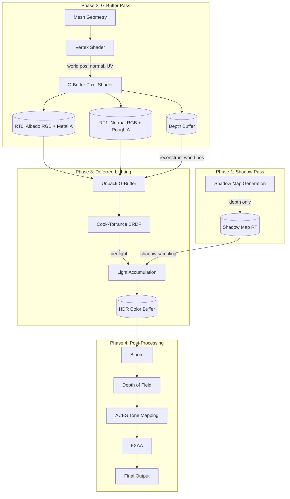

# PBR Pipeline Porting Guide: Overview

This documentation package provides everything needed to implement the apEx/Phoenix PBR rendering pipeline in Rust + WGPU + WGSL. Each document is self-contained with annotated shaders and complete implementation guides.

## Pipeline Architecture



## Render Targets and Resources

### G-Buffer Layout

| Target | Format | RGB Channels | Alpha Channel |
|--------|--------|--------------|---------------|
| RT0 | RGBA8Unorm | Albedo color | Metalness |
| RT1 | RGBA16Float | World normal (signed) | Roughness |
| Depth | Depth32Float | Depth | - |

### Bind Group Organization

```
Group 0: Scene (per-frame)
  - SceneUniforms buffer
  - Shadow map sampler + texture
  - LTC lookup textures (if using area lights)

Group 1: Object (per-draw)
  - ObjectUniforms buffer

Group 2: Material (per-material)
  - Albedo texture + sampler
  - Normal texture + sampler

Group 3: G-Buffer (lighting pass)
  - RT0 texture
  - RT1 texture
  - Depth texture
```

## Implementation Phases

### Phase 1: Minimal Renderer
**Goal**: Render PBR scene with point lights

**Documents**: 01-data-structures.md, 02-gbuffer-pass.md, 03-deferred-lighting.md

**Shaders**:
- `common.wgsl` - BRDF functions, transforms
- `gbuffer.wgsl` - G-Buffer generation
- `lighting-point.wgsl` - Point/spot/directional lights
- `ambient.wgsl` - IBL ambient pass

**Milestones**:
1. G-Buffer renders correctly (visualize RT0/RT1)
2. World position reconstructs from depth
3. Single point light illuminates scene
4. Multiple lights accumulate with additive blending

### Phase 2: Production Features
**Goal**: Emissive materials and shadows

**Documents**: 04-mixed-rendering.md, 06-shadow-mapping.md

**Shaders**:
- `shadow-pass.wgsl` - Depth-only shadow rendering
- Mixed rendering additions to gbuffer shader

**Milestones**:
1. Shadow map generates correct depth
2. PCF shadow sampling produces soft shadows
3. Emissive surfaces glow while writing G-Buffer

### Phase 3: Advanced Lighting
**Goal**: Soft area light reflections

**Documents**: 05-ltc-area-lights.md

**Shaders**:
- `lighting-ltc.wgsl` - LTC area light evaluation

**Data**:
- `data/ltc.rs` - Embedded LTC lookup tables

**Milestones**:
1. LTC textures upload correctly (verify 16x16 dimensions)
2. Sphere light produces soft specular highlights
3. Polygon clipping handles horizon correctly

### Phase 4: Polish
**Goal**: Full cinematic output

**Documents**: 07-post-processing.md

**Shaders**:
- `post/aces.wgsl` - Tone mapping
- `post/bloom.wgsl` - 7-pass bloom
- `post/dof.wgsl` - Depth of field
- `post/fxaa.wgsl` - Anti-aliasing
- `post/ssao.wgsl` - Ambient occlusion
- `post/effects.wgsl` - Grain, sharpen, chromatic aberration

**Milestones**:
1. Ping-pong render target management works
2. Bloom extracts and blurs bright areas
3. ACES produces filmic tone curve
4. Full effect chain composes correctly

## Minimum Viable Implementation Checklist

```
[ ] WGPU device and queue initialization
[ ] Swap chain and depth buffer creation
[ ] G-Buffer render targets (RT0, RT1)

[ ] SceneUniforms buffer with camera matrices
[ ] ObjectUniforms buffer with world/inverse-transpose
[ ] Vertex buffer with position, normal, UV

[ ] G-Buffer render pass writes to MRT
[ ] Depth buffer binds as sampled texture
[ ] World position reconstruction shader works

[ ] Cook-Torrance BRDF compiles (D_GGX, F_Schlick, Vis_Smith)
[ ] Single light illuminates test scene
[ ] Additive blending accumulates multiple lights

[ ] Ambient pass adds base illumination
[ ] Basic scene renders with PBR materials
```

## Existing Documentation (Reference)

For theory and background, see the existing analysis documents. This porting guide assumes familiarity with these concepts and focuses on implementation.

| Topic | Document | Key Content |
|-------|----------|-------------|
| Architecture | [../rendering/overview.md](../rendering/overview.md) | System design, mental model |
| Shaders | [../rendering/shaders.md](../rendering/shaders.md) | BRDF math, constant buffers |
| G-Buffer | [../rendering/deferred.md](../rendering/deferred.md) | Layout, packing, reconstruction |
| Lighting | [../rendering/lighting.md](../rendering/lighting.md) | Light types, attenuation |
| Post-FX | [../rendering/post-processing.md](../rendering/post-processing.md) | Effect algorithms |
| LTC Theory | [../code-traces/ltc-area-lighting.md](../code-traces/ltc-area-lighting.md) | Mathematical foundation |
| PBR Flow | [../code-traces/pbr-pipeline.md](../code-traces/pbr-pipeline.md) | Data flow trace |

## Document Index

| Document | Purpose | Lines |
|----------|---------|-------|
| [01-data-structures.md](01-data-structures.md) | Rust structs, buffer layouts, bind groups | ~600 |
| [02-gbuffer-pass.md](02-gbuffer-pass.md) | G-Buffer generation with WGSL shader | ~800 |
| [03-deferred-lighting.md](03-deferred-lighting.md) | Point/spot/directional lights with BRDF | ~700 |
| [04-mixed-rendering.md](04-mixed-rendering.md) | Forward+deferred hybrid for emissive | ~500 |
| [05-ltc-area-lights.md](05-ltc-area-lights.md) | Complete LTC implementation with data | ~900 |
| [06-shadow-mapping.md](06-shadow-mapping.md) | Shadow pass and PCF sampling | ~400 |
| [07-post-processing.md](07-post-processing.md) | All 11 effects with WGSL shaders | ~1200 |
| [appendix/hlsl-wgsl-guide.md](appendix/hlsl-wgsl-guide.md) | Translation reference table | ~400 |
| [appendix/wgpu-patterns.md](appendix/wgpu-patterns.md) | Bind groups, render passes, pipelines | ~350 |
| [appendix/pitfalls-troubleshooting.md](appendix/pitfalls-troubleshooting.md) | Common problems and solutions | ~500 |

## Shader Index

| Shader | Lines | Purpose |
|--------|-------|---------|
| [shaders/common.wgsl](shaders/common.wgsl) | ~250 | BRDF, transforms, utilities |
| [shaders/gbuffer.wgsl](shaders/gbuffer.wgsl) | ~150 | G-Buffer generation |
| [shaders/lighting-point.wgsl](shaders/lighting-point.wgsl) | ~200 | Point/spot/directional |
| [shaders/lighting-ltc.wgsl](shaders/lighting-ltc.wgsl) | ~350 | LTC area lights |
| [shaders/ambient.wgsl](shaders/ambient.wgsl) | ~80 | IBL ambient |
| [shaders/shadow-pass.wgsl](shaders/shadow-pass.wgsl) | ~50 | Depth-only |
| [shaders/post/*.wgsl](shaders/post/) | ~460 | All post effects |

## Data Files

| File | Size | Purpose |
|------|------|---------|
| [data/ltc.rs](data/ltc.rs) | 2,560 bytes | LTC tables as Rust const arrays |

## Test Scene

| File | Purpose |
|------|---------|
| [test-scene/geometry.rs](test-scene/geometry.rs) | Procedural mesh generation (sphere, cube, plane) |
| [test-scene/scene.rs](test-scene/scene.rs) | Camera, lights, materials, test configurations |
| [test-scene/expected-output.md](test-scene/expected-output.md) | Visual reference for each implementation milestone |

## Critical Translation Notes

### Coordinate Systems
- WGPU uses Y-up, right-handed coordinates
- Clip space Z is [0, 1] not [-1, 1]
- UV origin is top-left (same as D3D11)

### Matrix Layout
- WGSL uses column-major storage
- `mat4x4<f32>` expects column vectors
- Use `bytemuck` for Rust struct → GPU buffer

### Texture Sampling
- WGSL: `textureSample(t, s, uv)` not `t.Sample(s, uv)`
- Load (no filtering): `textureLoad(t, coords, level)`
- Depth comparison: `textureSampleCompare()`

## Verification Checklist

After implementation:

```
[ ] All WGSL shaders compile with naga validator
[ ] Rust structs match WGSL struct layouts (bytemuck compatible)
[ ] LTC data produces correct texture dimensions (16x16)
[ ] Cross-reference links to existing docs work
[ ] Implementation order produces working milestones
[ ] G-Buffer visualizations match expected output
[ ] BRDF produces physically plausible results
[ ] Post-processing chain order is correct
```

## Next Steps

1. Start with [01-data-structures.md](01-data-structures.md) to define Rust types
2. Implement G-Buffer pass using [02-gbuffer-pass.md](02-gbuffer-pass.md)
3. Add lighting with [03-deferred-lighting.md](03-deferred-lighting.md)
4. Verify basic rendering works before adding shadows/area lights
5. Add post-processing last for visual polish

**When things go wrong**: Consult [appendix/pitfalls-troubleshooting.md](appendix/pitfalls-troubleshooting.md) for common issues including:
- Coordinate system mismatches (upside-down rendering, shadow errors)
- Matrix layout confusion (row-major vs column-major)
- Buffer alignment requirements (the `vec3` trap)
- Platform-specific differences (Metal vs Vulkan vs WebGPU)
