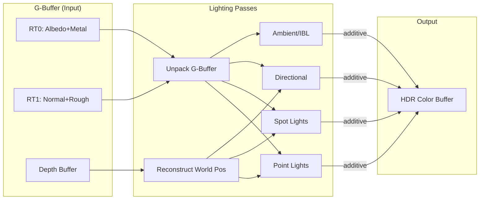

# Deferred Lighting Pass

The deferred lighting pass reads the G-Buffer and calculates per-pixel illumination without re-rendering geometry. Each light type renders as a full-screen pass with additive blending, accumulating into an HDR color buffer.

## Pipeline Architecture



## World Position Reconstruction

The G-Buffer stores depth instead of world position to save bandwidth. World position is reconstructed per-pixel in the lighting pass.

### Reconstruction Algorithm

```
1. Read depth buffer at pixel location
2. Convert screen UV [0,1] to NDC [-1,1]
3. Create clip-space position: (ndc.x, ndc.y, depth, 1)
4. Multiply by inverse projection → view-space position
5. Multiply by inverse view → world-space position
6. Perspective divide: xyz / w
```

### WGSL Implementation

```wgsl
fn get_world_position(depth: f32, uv: vec2<f32>, inverse_proj: mat4x4<f32>, inverse_view: mat4x4<f32>) -> vec3<f32> {
    // Convert UV [0,1] to NDC [-1,1]
    // Note: WGPU uses top-left origin, Y may need flip depending on convention
    let ndc = vec2<f32>(uv.x * 2.0 - 1.0, (1.0 - uv.y) * 2.0 - 1.0);

    // Build clip-space position
    // WGPU depth range is [0,1], not [-1,1]
    let clip_pos = vec4<f32>(ndc.x, ndc.y, depth, 1.0);

    // Unproject through inverse matrices
    let view_pos = inverse_proj * clip_pos;
    let world_pos = inverse_view * view_pos;

    // Perspective divide
    return world_pos.xyz / world_pos.w;
}
```

## G-Buffer Unpacking

Convert packed G-Buffer data to physically-based diffuse and specular colors.

```wgsl
struct GBufferData {
    world_normal: vec3<f32>,
    diffuse_color: vec3<f32>,
    specular_color: vec3<f32>,
    roughness: f32,
}

fn unpack_gbuffer(albedo_metalness: vec4<f32>, normal_roughness: vec4<f32>) -> GBufferData {
    var data: GBufferData;

    let albedo = albedo_metalness.rgb;
    let metalness = albedo_metalness.a;

    data.world_normal = normalize(normal_roughness.xyz);
    data.roughness = max(normal_roughness.a, 0.04); // Minimum roughness prevents divide-by-zero

    // Metalness workflow interpretation:
    // Diffuse: Metals have no diffuse (it's all specular), dielectrics have full albedo
    data.diffuse_color = albedo * (1.0 - metalness);

    // Specular F0: Non-metals reflect ~4% at normal incidence, metals reflect their albedo
    data.specular_color = mix(vec3<f32>(0.04), albedo, metalness);

    return data;
}
```

## Cook-Torrance BRDF

The specular BRDF combines three terms: Distribution (D), Fresnel (F), and Visibility/Geometry (G).

### GGX Distribution (D)

Models how microfacets are oriented. GGX produces realistic "long tail" highlights.

```wgsl
fn D_GGX(a2: f32, n_dot_h: f32) -> f32 {
    let d = (n_dot_h * a2 - n_dot_h) * n_dot_h + 1.0;
    return a2 / (PI * d * d);
}
```

### Schlick Fresnel (F)

Approximates how reflectance increases at grazing angles.

```wgsl
fn F_Schlick(specular_color: vec3<f32>, v_dot_h: f32) -> vec3<f32> {
    let Fc = pow(1.0 - v_dot_h, 5.0);
    // Edge tint enhancement for dielectrics
    return saturate(50.0 * specular_color.g) * Fc + (1.0 - Fc) * specular_color;
}
```

### Smith-GGX Visibility (G)

Accounts for microfacet self-shadowing and masking.

```wgsl
fn Vis_SmithJointApprox(a2: f32, n_dot_v: f32, n_dot_l: f32) -> f32 {
    let a = sqrt(a2);
    let Vis_SmithV = n_dot_l * (n_dot_v * (1.0 - a) + a);
    let Vis_SmithL = n_dot_v * (n_dot_l * (1.0 - a) + a);
    return 0.5 / (Vis_SmithV + Vis_SmithL + 0.0001);
}
```

### Combined Specular BRDF

```wgsl
fn SpecularGGX(roughness: f32, specular_color: vec3<f32>, ctx: BrdfContext, n_dot_l: f32) -> vec3<f32> {
    let a2 = pow(roughness, 4.0); // roughness^4 for perceptual linearity

    let D = D_GGX(a2, ctx.n_dot_h);
    let Vis = Vis_SmithJointApprox(a2, ctx.n_dot_v, n_dot_l);
    let F = F_Schlick(specular_color, ctx.v_dot_h);

    return (D * Vis) * F;
}
```

## Pipeline Configuration

```rust
pub fn create_lighting_pipeline(
    device: &wgpu::Device,
    scene_layout: &wgpu::BindGroupLayout,
    gbuffer_layout: &wgpu::BindGroupLayout,
    light_layout: &wgpu::BindGroupLayout,
) -> wgpu::RenderPipeline {
    let shader = device.create_shader_module(wgpu::ShaderModuleDescriptor {
        label: Some("Deferred Lighting Shader"),
        source: wgpu::ShaderSource::Wgsl(include_str!("shaders/lighting-point.wgsl").into()),
    });

    let layout = device.create_pipeline_layout(&wgpu::PipelineLayoutDescriptor {
        label: Some("Deferred Lighting Pipeline Layout"),
        bind_group_layouts: &[scene_layout, gbuffer_layout, light_layout],
        push_constant_ranges: &[],
    });

    device.create_render_pipeline(&wgpu::RenderPipelineDescriptor {
        label: Some("Deferred Lighting Pipeline"),
        layout: Some(&layout),
        vertex: wgpu::VertexState {
            module: &shader,
            entry_point: Some("vs_fullscreen"),
            buffers: &[], // No vertex buffer - generate triangle in shader
            compilation_options: Default::default(),
        },
        fragment: Some(wgpu::FragmentState {
            module: &shader,
            entry_point: Some("fs_point_light"),
            targets: &[Some(wgpu::ColorTargetState {
                format: wgpu::TextureFormat::Rgba16Float, // HDR output
                blend: Some(wgpu::BlendState {
                    color: wgpu::BlendComponent {
                        src_factor: wgpu::BlendFactor::One,
                        dst_factor: wgpu::BlendFactor::One,
                        operation: wgpu::BlendOperation::Add,
                    },
                    alpha: wgpu::BlendComponent::OVER,
                }),
                write_mask: wgpu::ColorWrites::ALL,
            })],
            compilation_options: Default::default(),
        }),
        primitive: wgpu::PrimitiveState {
            topology: wgpu::PrimitiveTopology::TriangleList,
            ..Default::default()
        },
        depth_stencil: None, // No depth testing for full-screen lighting
        multisample: wgpu::MultisampleState::default(),
        multiview: None,
        cache: None,
    })
}
```

## Render Pass Execution

```rust
pub fn render_lighting_pass(
    encoder: &mut wgpu::CommandEncoder,
    hdr_view: &wgpu::TextureView,
    scene_bind_group: &wgpu::BindGroup,
    gbuffer_bind_group: &wgpu::BindGroup,
    light_bind_groups: &[wgpu::BindGroup], // One per light
    pipeline: &wgpu::RenderPipeline,
    clear: bool,
) {
    let load_op = if clear {
        wgpu::LoadOp::Clear(wgpu::Color::BLACK)
    } else {
        wgpu::LoadOp::Load
    };

    let mut pass = encoder.begin_render_pass(&wgpu::RenderPassDescriptor {
        label: Some("Deferred Lighting Pass"),
        color_attachments: &[Some(wgpu::RenderPassColorAttachment {
            view: hdr_view,
            resolve_target: None,
            ops: wgpu::Operations {
                load: load_op,
                store: wgpu::StoreOp::Store,
            },
        })],
        depth_stencil_attachment: None,
        timestamp_writes: None,
        occlusion_query_set: None,
    });

    pass.set_pipeline(pipeline);
    pass.set_bind_group(0, scene_bind_group, &[]);
    pass.set_bind_group(1, gbuffer_bind_group, &[]);

    // Render each light with additive blending
    for light_bind_group in light_bind_groups {
        pass.set_bind_group(2, light_bind_group, &[]);
        pass.draw(0..3, 0..1); // Full-screen triangle
    }
}
```

## Point/Spot/Directional Light Shader

See [shaders/lighting-point.wgsl](shaders/lighting-point.wgsl) for the complete implementation.

### Key Differences by Light Type

| Light Type | Position | Direction | Attenuation |
|------------|----------|-----------|-------------|
| Point | World position | Computed per-pixel | Inverse-square distance |
| Spot | World position | Fixed cone direction | Distance × angular falloff |
| Directional | N/A | Fixed direction | None (infinite distance) |

### Point Light Specifics

```wgsl
// Point light: position is in world space
let to_light = light.position.xyz - world_pos;
let distance_sq = dot(to_light, to_light);
let falloff = 1.0 / (distance_sq + 1.0);
let L = normalize(to_light);
```

### Spot Light Specifics

```wgsl
// Spot light adds angular attenuation
let L = normalize(light.position.xyz - world_pos);
let spot_dir = normalize(light.specular.xyz); // Spot direction stored here
let cos_angle = dot(-L, spot_dir);
let inner_angle = light.specular.w; // Cosine of inner cone
let outer_angle = light.ambient.w;  // Cosine of outer cone
let angular_atten = saturate((cos_angle - outer_angle) / (inner_angle - outer_angle));
```

### Directional Light Specifics

```wgsl
// Directional light: position.xyz is actually the direction
let L = normalize(-light.position.xyz);
// No distance attenuation
let falloff = 1.0;
```

## Ambient/IBL Pass

The ambient pass adds image-based lighting contribution. For simplicity, this implementation uses a constant ambient color rather than a full IBL environment map.

See [shaders/ambient.wgsl](shaders/ambient.wgsl) for the implementation.

```wgsl
// Simplified ambient using Fresnel to balance diffuse/specular
fn ambient_ibl(N: vec3<f32>, V: vec3<f32>, f0: vec3<f32>, albedo: vec3<f32>, metallic: f32, ambient_color: vec3<f32>) -> vec3<f32> {
    let H = normalize(V + N);
    let F = F_Schlick(f0, max(dot(H, V), 0.0));

    // Fresnel determines how much goes to specular vs diffuse
    // More specular at grazing angles, more diffuse at normal incidence
    let kD = (1.0 - F) * (1.0 - metallic);

    return kD * ambient_color * albedo / PI;
}
```

## Full-Screen Triangle Generation

Instead of a quad (6 vertices), use a single triangle that covers clip space:

```wgsl
@vertex
fn vs_fullscreen(@builtin(vertex_index) vertex_index: u32) -> FullscreenOutput {
    var out: FullscreenOutput;

    // Generate positions for a triangle that covers [-1,1] × [-1,1]
    // Vertex 0: (-1, -1), Vertex 1: (3, -1), Vertex 2: (-1, 3)
    let x = f32(i32(vertex_index) / 2) * 4.0 - 1.0;
    let y = f32(i32(vertex_index) % 2) * 4.0 - 1.0;

    out.clip_position = vec4<f32>(x, y, 0.0, 1.0);

    // Convert clip coords to UV [0,1]
    out.uv = vec2<f32>(x, -y) * 0.5 + 0.5;

    return out;
}
```

## Detecting Empty G-Buffer Pixels

Pixels where no geometry was rendered have a zero-length normal (cleared to transparent):

```wgsl
// Skip lighting for sky/background pixels
let normal = textureSample(normal_roughness_texture, sampler, uv).xyz;
if length(normal) < 0.1 {
    return vec4<f32>(0.0);  // No contribution from this light
}
```

## Common Issues and Solutions

### Problem: Lighting looks flat/incorrect

**Check**:
1. World position reconstruction - visualize by outputting `fract(world_pos)` as color
2. Normal unpacking - ensure RT1 format supports signed values (Rgba16Float)
3. BRDF dot products - all should be clamped appropriately

### Problem: Specular highlights are too bright/dark

**Check**:
1. Roughness minimum - clamp to 0.04 to prevent divide-by-zero
2. Energy normalization - verify Vis term includes `0.5 /` factor
3. Fresnel F0 - non-metals should be ~0.04, not albedo

### Problem: Additive blending causes oversaturation

**Solution**: Use HDR buffer (Rgba16Float) and apply tone mapping after all lights are accumulated.

### Problem: Light volumes clip incorrectly

For point/spot lights with limited range, you can render light volumes instead of full-screen passes. However, the full-screen approach is simpler and often fast enough with modern GPUs.

## Related Documents

- [02-gbuffer-pass.md](02-gbuffer-pass.md) - G-Buffer generation
- [05-ltc-area-lights.md](05-ltc-area-lights.md) - LTC area lights
- [06-shadow-mapping.md](06-shadow-mapping.md) - Shadow integration
- [shaders/lighting-point.wgsl](shaders/lighting-point.wgsl) - Full shader implementation
- [shaders/ambient.wgsl](shaders/ambient.wgsl) - Ambient pass shader
