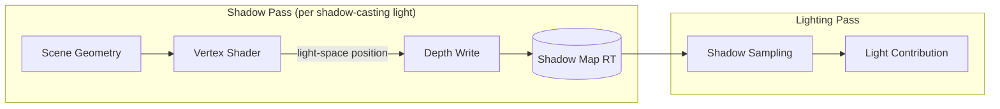

# Shadow Mapping

Shadow mapping uses a depth-only render pass from the light's perspective, then samples this depth during lighting to determine shadow visibility.

## Shadow Pass Architecture



## Shadow Map Creation

```rust
pub struct ShadowMap {
    pub texture: wgpu::Texture,
    pub view: wgpu::TextureView,
    pub sampler: wgpu::Sampler,
    pub size: u32,
}

impl ShadowMap {
    pub fn new(device: &wgpu::Device, size: u32) -> Self {
        let texture = device.create_texture(&wgpu::TextureDescriptor {
            label: Some("Shadow Map"),
            size: wgpu::Extent3d {
                width: size,
                height: size,
                depth_or_array_layers: 1,
            },
            mip_level_count: 1,
            sample_count: 1,
            dimension: wgpu::TextureDimension::D2,
            format: wgpu::TextureFormat::Depth32Float,
            usage: wgpu::TextureUsages::RENDER_ATTACHMENT
                 | wgpu::TextureUsages::TEXTURE_BINDING,
            view_formats: &[],
        });

        let view = texture.create_view(&wgpu::TextureViewDescriptor::default());

        // Comparison sampler for hardware PCF
        let sampler = device.create_sampler(&wgpu::SamplerDescriptor {
            label: Some("Shadow Sampler"),
            address_mode_u: wgpu::AddressMode::ClampToEdge,
            address_mode_v: wgpu::AddressMode::ClampToEdge,
            address_mode_w: wgpu::AddressMode::ClampToEdge,
            mag_filter: wgpu::FilterMode::Linear,
            min_filter: wgpu::FilterMode::Linear,
            mipmap_filter: wgpu::FilterMode::Nearest,
            compare: Some(wgpu::CompareFunction::LessEqual),
            ..Default::default()
        });

        Self { texture, view, sampler, size }
    }
}
```

## Light-Space Matrix Construction

### Directional Light (Orthographic)

```rust
pub fn directional_light_matrix(
    direction: glam::Vec3,
    scene_center: glam::Vec3,
    scene_radius: f32,
) -> (glam::Mat4, glam::Mat4) {
    // View matrix: look along light direction
    let light_pos = scene_center - direction.normalize() * scene_radius * 2.0;
    let view = glam::Mat4::look_at_rh(light_pos, scene_center, glam::Vec3::Y);

    // Orthographic projection sized to scene bounds
    let half_size = scene_radius * 1.5;
    let projection = glam::Mat4::orthographic_rh(
        -half_size, half_size,  // left, right
        -half_size, half_size,  // bottom, top
        0.1,                     // near
        scene_radius * 4.0,      // far
    );

    (view, projection)
}
```

### Spot Light (Perspective)

```rust
pub fn spot_light_matrix(
    position: glam::Vec3,
    direction: glam::Vec3,
    outer_angle: f32,  // radians
    near: f32,
    far: f32,
) -> (glam::Mat4, glam::Mat4) {
    let view = glam::Mat4::look_at_rh(
        position,
        position + direction.normalize(),
        glam::Vec3::Y,
    );

    // Perspective projection with FOV based on spot cone
    let fov = outer_angle * 2.0;
    let projection = glam::Mat4::perspective_rh(fov, 1.0, near, far);

    (view, projection)
}
```

## Shadow Pass Pipeline

```rust
pub fn create_shadow_pipeline(
    device: &wgpu::Device,
    scene_layout: &wgpu::BindGroupLayout,
    object_layout: &wgpu::BindGroupLayout,
) -> wgpu::RenderPipeline {
    let shader = device.create_shader_module(wgpu::ShaderModuleDescriptor {
        label: Some("Shadow Pass Shader"),
        source: wgpu::ShaderSource::Wgsl(include_str!("shaders/shadow-pass.wgsl").into()),
    });

    let layout = device.create_pipeline_layout(&wgpu::PipelineLayoutDescriptor {
        label: Some("Shadow Pipeline Layout"),
        bind_group_layouts: &[scene_layout, object_layout],
        push_constant_ranges: &[],
    });

    device.create_render_pipeline(&wgpu::RenderPipelineDescriptor {
        label: Some("Shadow Pipeline"),
        layout: Some(&layout),
        vertex: wgpu::VertexState {
            module: &shader,
            entry_point: Some("vs_main"),
            buffers: &[Vertex::desc()],
            compilation_options: Default::default(),
        },
        fragment: None, // Depth-only, no fragment shader needed
        primitive: wgpu::PrimitiveState {
            topology: wgpu::PrimitiveTopology::TriangleList,
            front_face: wgpu::FrontFace::Ccw,
            // Use front-face culling to reduce shadow acne
            cull_mode: Some(wgpu::Face::Front),
            ..Default::default()
        },
        depth_stencil: Some(wgpu::DepthStencilState {
            format: wgpu::TextureFormat::Depth32Float,
            depth_write_enabled: true,
            depth_compare: wgpu::CompareFunction::Less,
            stencil: wgpu::StencilState::default(),
            // Depth bias to reduce shadow acne
            bias: wgpu::DepthBiasState {
                constant: 2,
                slope_scale: 2.0,
                clamp: 0.0,
            },
        }),
        multisample: wgpu::MultisampleState::default(),
        multiview: None,
        cache: None,
    })
}
```

## Shadow Pass Shader

```wgsl
// shadow-pass.wgsl - Depth-only shadow map generation
//
// Renders scene from light's perspective, writing only depth.

// ============================================================================
// Bind Groups
// ============================================================================

struct ShadowUniforms {
    light_view: mat4x4<f32>,
    light_projection: mat4x4<f32>,
}

@group(0) @binding(0) var<uniform> shadow: ShadowUniforms;

struct ObjectUniforms {
    world: mat4x4<f32>,
    inverse_transpose_world: mat4x4<f32>,
    material_params: vec4<f32>,
}

@group(1) @binding(0) var<uniform> object: ObjectUniforms;

// ============================================================================
// Vertex Stage
// ============================================================================

struct VertexInput {
    @location(0) position: vec3<f32>,
    @location(1) normal: vec3<f32>,
    @location(2) uv: vec2<f32>,
    @location(3) color: vec4<f32>,
}

@vertex
fn vs_main(in: VertexInput) -> @builtin(position) vec4<f32> {
    let world_pos = object.world * vec4<f32>(in.position, 1.0);
    let light_space = shadow.light_projection * shadow.light_view * world_pos;
    return light_space;
}

// No fragment shader - depth-only rendering
// The depth buffer is automatically written by the rasterizer
```

## Shadow Sampling in Lighting Shader

### Basic Shadow Test

```wgsl
fn sample_shadow_basic(
    shadow_map: texture_depth_2d,
    shadow_sampler: sampler_comparison,
    light_space_pos: vec4<f32>,
) -> f32 {
    // Perspective divide and convert to UV
    let shadow_coords = light_space_pos.xyz / light_space_pos.w;
    let uv = shadow_coords.xy * 0.5 + 0.5;

    // Flip Y for WGPU coordinate system
    let shadow_uv = vec2<f32>(uv.x, 1.0 - uv.y);

    // Check bounds
    if any(shadow_uv < vec2<f32>(0.0)) || any(shadow_uv > vec2<f32>(1.0)) {
        return 1.0; // Outside shadow map = lit
    }

    // Sample with comparison
    return textureSampleCompare(shadow_map, shadow_sampler, shadow_uv, shadow_coords.z);
}
```

### PCF (Percentage Closer Filtering)

5×5 kernel for soft shadow edges:

```wgsl
fn sample_shadow_pcf(
    shadow_map: texture_depth_2d,
    shadow_sampler: sampler_comparison,
    light_space_pos: vec4<f32>,
    shadow_map_size: f32,
    softness: f32,
) -> f32 {
    let shadow_coords = light_space_pos.xyz / light_space_pos.w;
    let uv = shadow_coords.xy * 0.5 + 0.5;
    let shadow_uv = vec2<f32>(uv.x, 1.0 - uv.y);

    if any(shadow_uv < vec2<f32>(0.0)) || any(shadow_uv > vec2<f32>(1.0)) {
        return 1.0;
    }

    let texel_size = 1.0 / shadow_map_size;
    var shadow: f32 = 0.0;

    // 5×5 PCF kernel
    for (var x: i32 = -2; x <= 2; x = x + 1) {
        for (var y: i32 = -2; y <= 2; y = y + 1) {
            let offset = vec2<f32>(f32(x), f32(y)) * texel_size * softness;
            shadow += textureSampleCompare(
                shadow_map,
                shadow_sampler,
                shadow_uv + offset,
                shadow_coords.z
            );
        }
    }

    return shadow / 25.0;
}
```

### Integration in Lighting Shader

```wgsl
// In the lighting shader fragment function:

fn evaluate_point_light_with_shadow(
    gbuffer: GBufferData,
    world_pos: vec3<f32>,
    V: vec3<f32>,
    shadow_map: texture_depth_2d,
    shadow_sampler: sampler_comparison,
    light_view_proj: mat4x4<f32>,
) -> vec3<f32> {
    // Calculate light contribution (same as before)
    let lit_color = evaluate_point_light(gbuffer, world_pos, V);

    // Transform to light space
    let light_space_pos = light_view_proj * vec4<f32>(world_pos, 1.0);

    // Sample shadow
    let shadow = sample_shadow_pcf(
        shadow_map,
        shadow_sampler,
        light_space_pos,
        1024.0,  // shadow map size
        1.0      // softness
    );

    return lit_color * shadow;
}
```

## Shadow Bias Strategies

Shadow acne occurs when depth precision is insufficient. Several strategies help:

### 1. Depth Bias (Pipeline State)

```rust
bias: wgpu::DepthBiasState {
    constant: 2,      // Fixed bias in depth units
    slope_scale: 2.0, // Bias proportional to surface slope
    clamp: 0.0,       // Max bias (0 = no clamp)
},
```

### 2. Normal Offset

Push sample position along surface normal before transforming to light space:

```wgsl
let biased_pos = world_pos + gbuffer.world_normal * normal_offset_scale;
let light_space_pos = light_view_proj * vec4<f32>(biased_pos, 1.0);
```

### 3. Receiver Plane Depth Bias

Compute bias based on the light-to-surface angle:

```wgsl
let n_dot_l = max(dot(gbuffer.world_normal, light_direction), 0.0);
let bias = max(0.001 * (1.0 - n_dot_l), 0.0001);
let shadow_test_depth = shadow_coords.z - bias;
```

### 4. Front-Face Culling in Shadow Pass

Render back faces to shadow map instead of front faces. This naturally biases depth outward.

## Variance Shadow Maps (VSM)

For softer shadows without multi-tap PCF, store depth and depth² in RG channels:

```wgsl
// Shadow pass fragment shader for VSM
@fragment
fn fs_vsm(@builtin(position) position: vec4<f32>) -> @location(0) vec2<f32> {
    let depth = position.z;
    return vec2<f32>(depth, depth * depth);
}

// VSM sampling
fn sample_shadow_vsm(
    shadow_map: texture_2d<f32>,
    shadow_sampler: sampler,
    uv: vec2<f32>,
    compare_depth: f32,
) -> f32 {
    let moments = textureSample(shadow_map, shadow_sampler, uv).rg;

    // One-tailed Chebyshev inequality
    let mean = moments.x;
    let variance = max(moments.y - mean * mean, 0.0001);

    let d = compare_depth - mean;
    let p_max = variance / (variance + d * d);

    return select(p_max, 1.0, compare_depth <= mean);
}
```

## Render Pass Configuration

```rust
pub fn render_shadow_pass(
    encoder: &mut wgpu::CommandEncoder,
    shadow_map: &ShadowMap,
    shadow_bind_group: &wgpu::BindGroup,
    meshes: &[(Mesh, wgpu::BindGroup)],
    pipeline: &wgpu::RenderPipeline,
) {
    let mut pass = encoder.begin_render_pass(&wgpu::RenderPassDescriptor {
        label: Some("Shadow Pass"),
        color_attachments: &[], // No color output
        depth_stencil_attachment: Some(wgpu::RenderPassDepthStencilAttachment {
            view: &shadow_map.view,
            depth_ops: Some(wgpu::Operations {
                load: wgpu::LoadOp::Clear(1.0),
                store: wgpu::StoreOp::Store,
            }),
            stencil_ops: None,
        }),
        timestamp_writes: None,
        occlusion_query_set: None,
    });

    pass.set_pipeline(pipeline);
    pass.set_bind_group(0, shadow_bind_group, &[]);

    for (mesh, object_bind_group) in meshes {
        pass.set_bind_group(1, object_bind_group, &[]);
        pass.set_vertex_buffer(0, mesh.vertex_buffer.slice(..));
        pass.set_index_buffer(mesh.index_buffer.slice(..), wgpu::IndexFormat::Uint32);
        pass.draw_indexed(0..mesh.index_count, 0, 0..1);
    }
}
```

## Related Documents

- [03-deferred-lighting.md](03-deferred-lighting.md) - Shadow integration in lighting
- [04-mixed-rendering.md](04-mixed-rendering.md) - Forward shadow sampling
- [shaders/shadow-pass.wgsl](shaders/shadow-pass.wgsl) - Shadow pass shader
