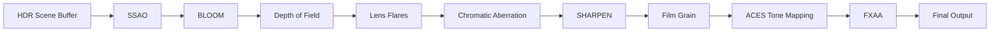

# Post-Processing Pipeline

Post-processing transforms the rendered HDR image into final cinematic output. Effects execute as full-screen passes, reading from one render target and writing to another (ping-pong rendering).

## Pipeline Architecture



## Effect Order

Effects must execute in a specific order based on their requirements:

| Phase | Effect | Reason |
|-------|--------|--------|
| Early | SSAO | Modifies ambient before final lighting |
| Early | SSR | Needs G-Buffer before it's discarded |
| HDR | Bloom | Must extract bright values before tone mapping |
| HDR | Depth of Field | Blur in linear space |
| HDR | Lens Flares | Ghost extraction from HDR |
| HDR | Chromatic Aberration | Works in linear space |
| HDR | Sharpen | Before compression |
| HDR | Film Grain | Before compression |
| LDR | ACES Tone Mapping | HDR → LDR conversion |
| Final | FXAA | Operates on final LDR with luminance |

## Ping-Pong Render Target Management

```rust
pub struct PostProcessTargets {
    pub rt_a: wgpu::Texture,
    pub rt_a_view: wgpu::TextureView,
    pub rt_b: wgpu::Texture,
    pub rt_b_view: wgpu::TextureView,
    current: bool, // false = A is current, true = B is current
}

impl PostProcessTargets {
    pub fn new(device: &wgpu::Device, width: u32, height: u32) -> Self {
        let create_rt = |label: &str| {
            device.create_texture(&wgpu::TextureDescriptor {
                label: Some(label),
                size: wgpu::Extent3d { width, height, depth_or_array_layers: 1 },
                mip_level_count: 1,
                sample_count: 1,
                dimension: wgpu::TextureDimension::D2,
                format: wgpu::TextureFormat::Rgba16Float,
                usage: wgpu::TextureUsages::RENDER_ATTACHMENT
                     | wgpu::TextureUsages::TEXTURE_BINDING,
                view_formats: &[],
            })
        };

        let rt_a = create_rt("Post RT A");
        let rt_b = create_rt("Post RT B");

        Self {
            rt_a_view: rt_a.create_view(&Default::default()),
            rt_a,
            rt_b_view: rt_b.create_view(&Default::default()),
            rt_b,
            current: false,
        }
    }

    /// Get current source and destination for next effect
    pub fn swap(&mut self) -> (&wgpu::TextureView, &wgpu::TextureView) {
        self.current = !self.current;
        if self.current {
            (&self.rt_a_view, &self.rt_b_view) // Read A, write B
        } else {
            (&self.rt_b_view, &self.rt_a_view) // Read B, write A
        }
    }
}
```

## ACES Tone Mapping

ACES (Academy Color Encoding System) provides industry-standard HDR to LDR conversion.

```wgsl
// post/aces.wgsl - ACES filmic tone mapping

const ACES_INPUT_MAT: mat3x3<f32> = mat3x3<f32>(
    vec3<f32>(0.59719, 0.07600, 0.02840),
    vec3<f32>(0.35458, 0.90834, 0.13383),
    vec3<f32>(0.04823, 0.01566, 0.83777)
);

const ACES_OUTPUT_MAT: mat3x3<f32> = mat3x3<f32>(
    vec3<f32>( 1.60475, -0.10208, -0.00327),
    vec3<f32>(-0.53108,  1.10813, -0.07276),
    vec3<f32>(-0.07367, -0.00605,  1.07602)
);

@group(0) @binding(0) var input_texture: texture_2d<f32>;
@group(0) @binding(1) var input_sampler: sampler;

struct FullscreenOutput {
    @builtin(position) position: vec4<f32>,
    @location(0) uv: vec2<f32>,
}

@vertex
fn vs_main(@builtin(vertex_index) vertex_index: u32) -> FullscreenOutput {
    var out: FullscreenOutput;
    let x = f32(i32(vertex_index) / 2) * 4.0 - 1.0;
    let y = f32(i32(vertex_index) % 2) * 4.0 - 1.0;
    out.position = vec4<f32>(x, y, 0.0, 1.0);
    out.uv = vec2<f32>((x + 1.0) * 0.5, (1.0 - y) * 0.5);
    return out;
}

@fragment
fn fs_main(in: FullscreenOutput) -> @location(0) vec4<f32> {
    var color = textureSample(input_texture, input_sampler, in.uv).rgb;

    // Transform to ACES color space
    color = ACES_INPUT_MAT * color;

    // RRT+ODT rational polynomial approximation
    // S-curve: lifts blacks, maintains midtones, rolls off highlights
    let a = color * (color + 0.0245786) - 0.000090537;
    let b = color * (0.983729 * color + 0.4329510) + 0.238081;
    color = a / b;

    // Transform back to output color space
    color = ACES_OUTPUT_MAT * color;

    // Clamp to [0, 1]
    return vec4<f32>(saturate(color), 1.0);
}
```

## Bloom (7-Pass)

Multi-pass progressive downsampling bloom extracts bright areas and creates soft glow.

### Pass 1: Threshold + Horizontal Blur

```wgsl
// post/bloom.wgsl - Bloom effect

struct BloomParams {
    blur_size: vec2<f32>,
    sample_count: f32,
    threshold: f32,
    power: f32,
    _padding: vec3<f32>,
}

@group(0) @binding(0) var input_texture: texture_2d<f32>;
@group(0) @binding(1) var input_sampler: sampler;
@group(0) @binding(2) var<uniform> params: BloomParams;

// Pass 1: Threshold extraction + horizontal blur (output to X/2, Y/1)
@fragment
fn fs_threshold_horizontal(in: FullscreenOutput) -> @location(0) vec4<f32> {
    var color = vec4<f32>(0.0);
    let count = params.sample_count * 255.0;

    for (var i: i32 = 0; i < i32(count); i = i + 1) {
        let offset = (f32(i) - (count - 1.0) / 2.0) * params.blur_size.x / count / 4.0;
        let sample_uv = in.uv + vec2<f32>(offset, 0.0);
        let sample_color = textureSample(input_texture, input_sampler, sample_uv);

        // Threshold test
        let above_threshold = vec4<f32>(sample_color >= vec4<f32>(params.threshold));

        // Extract bright part and amplify
        color += ((sample_color - params.threshold) * (1.0 + params.power * 1000.0) + params.threshold) * above_threshold;
    }

    return color / count;
}

// Pass 2-6: Separable blur (alternating H/V)
@fragment
fn fs_blur_vertical(in: FullscreenOutput) -> @location(0) vec4<f32> {
    var color = vec4<f32>(0.0);
    let count = params.sample_count * 255.0;

    for (var i: i32 = 0; i < i32(count); i = i + 1) {
        let offset = (f32(i) - (count - 1.0) / 2.0) * params.blur_size.y / count / 4.0;
        color += textureSample(input_texture, input_sampler, in.uv + vec2<f32>(0.0, offset));
    }

    return color / count;
}

@fragment
fn fs_blur_horizontal(in: FullscreenOutput) -> @location(0) vec4<f32> {
    var color = vec4<f32>(0.0);
    let count = params.sample_count * 255.0;

    for (var i: i32 = 0; i < i32(count); i = i + 1) {
        let offset = (f32(i) - (count - 1.0) / 2.0) * params.blur_size.x / count / 4.0;
        color += textureSample(input_texture, input_sampler, in.uv + vec2<f32>(offset, 0.0));
    }

    return color / count;
}

// Pass 7: Final tint and output
struct BloomOutputParams {
    tint_color: vec4<f32>,
}

@group(0) @binding(3) var<uniform> output_params: BloomOutputParams;

@fragment
fn fs_bloom_output(in: FullscreenOutput) -> @location(0) vec4<f32> {
    return textureSample(input_texture, input_sampler, in.uv) * output_params.tint_color;
}
```

## Depth of Field

Physically-based circle of confusion (CoC) calculation with depth-aware blur.

```wgsl
// post/dof.wgsl - Depth of field

struct DoFParams {
    focal_distance: f32,  // Focus plane distance
    focal_length: f32,    // Lens focal length
    aperture: f32,        // Aperture diameter
    bleed_mult: f32,      // Background bleed control
    bleed_bias: f32,
    _padding: vec3<f32>,
}

@group(0) @binding(0) var color_texture: texture_2d<f32>;
@group(0) @binding(1) var depth_texture: texture_2d<f32>;
@group(0) @binding(2) var texture_sampler: sampler;
@group(0) @binding(3) var<uniform> params: DoFParams;
@group(0) @binding(4) var<uniform> scene: SceneUniforms;

// Calculate Circle of Confusion from depth
fn calculate_coc(depth: f32) -> f32 {
    // Linearize depth
    let clip_pos = vec4<f32>(0.0, 0.0, depth, 1.0);
    let view_pos = scene.inverse_projection * clip_pos;
    let linear_depth = -view_pos.z / view_pos.w;

    // Thin lens CoC formula
    let S1 = params.focal_distance;
    let S2 = linear_depth;
    let f = params.focal_length;
    let A = params.aperture;

    let coc = A * abs(S2 - S1) / S2 * f / (S1 - f);

    // Normalize and clamp
    let coc_percent = coc / 0.024;
    return clamp(coc_percent, 0.0001, 0.12) * 0.3;
}

// Pass 1: CoC calculation (store in alpha)
@fragment
fn fs_coc_pass(in: FullscreenOutput) -> @location(0) vec4<f32> {
    let color = textureSample(color_texture, texture_sampler, in.uv);
    let depth = textureSample(depth_texture, texture_sampler, in.uv).x;
    let coc = calculate_coc(depth);
    return vec4<f32>(color.rgb, coc);
}

// Pass 2: Disc blur (8×8 samples)
@fragment
fn fs_disc_blur(in: FullscreenOutput) -> @location(0) vec4<f32> {
    let center = textureSample(color_texture, texture_sampler, in.uv);
    let center_coc = center.a;

    var blurred = vec4<f32>(0.0);
    var total_weight = 0.0;

    // Disc sampling pattern
    for (var y: i32 = 0; y < 8; y = y + 1) {
        for (var x: i32 = 0; x < 8; x = x + 1) {
            let offset = vec2<f32>(f32(x) - 3.5, f32(y) - 3.5) * center_coc * 0.1;
            let sample = textureSample(color_texture, texture_sampler, in.uv + offset);
            blurred += sample;
            total_weight += 1.0;
        }
    }

    return blurred / total_weight;
}

// Pass 3: Refinement with bleed prevention
@fragment
fn fs_refinement(in: FullscreenOutput) -> @location(0) vec4<f32> {
    let center = textureSample(color_texture, texture_sampler, in.uv);
    let center_depth = textureSample(depth_texture, texture_sampler, in.uv).x;
    let center_coc = center.a;

    var blurred = vec4<f32>(0.0);
    var total_weight = 0.0;

    // 3×3 refinement kernel
    for (var y: i32 = 0; y < 3; y = y + 1) {
        for (var x: i32 = 0; x < 3; x = x + 1) {
            let offset = vec2<f32>(f32(x) - 1.0, f32(y) - 1.0) * 0.085 * center_coc;
            let sample_uv = in.uv + offset;

            let sample_color = textureSample(color_texture, texture_sampler, sample_uv);
            let sample_depth = textureSample(depth_texture, texture_sampler, sample_uv).x;
            let sample_coc = sample_color.a;

            // Weight reduction for background samples to prevent bleed
            var weight = 1.0;
            if sample_depth < center_depth {
                weight = sample_coc * params.bleed_mult;
            }
            if center_coc <= sample_coc + params.bleed_bias {
                weight = 1.0;
            }

            blurred += sample_color * saturate(weight);
            total_weight += saturate(weight);
        }
    }

    return blurred / total_weight;
}
```

## FXAA (Fast Approximate Anti-Aliasing)

```wgsl
// post/fxaa.wgsl - FXAA 3.11 Quality preset

struct FxaaParams {
    rcp_frame: vec2<f32>,  // 1/resolution
    subpix: f32,           // Subpixel AA amount (0.75)
    edge_threshold: f32,   // Edge detection threshold (0.166)
    edge_threshold_min: f32, // Minimum edge threshold (0.0833)
    _padding: vec3<f32>,
}

@group(0) @binding(0) var input_texture: texture_2d<f32>;
@group(0) @binding(1) var input_sampler: sampler;
@group(0) @binding(2) var<uniform> params: FxaaParams;

// Luminance weights (Rec. 709)
fn luma(color: vec3<f32>) -> f32 {
    return dot(color, vec3<f32>(0.299, 0.587, 0.114));
}

// Pass 1: Luminance prepass (store in alpha)
@fragment
fn fs_luma_prepass(in: FullscreenOutput) -> @location(0) vec4<f32> {
    let color = textureSample(input_texture, input_sampler, in.uv).rgb;
    return vec4<f32>(color, luma(color));
}

// Pass 2: FXAA edge detection and blending
@fragment
fn fs_fxaa(in: FullscreenOutput) -> @location(0) vec4<f32> {
    let pos = in.uv;

    // Sample center and neighbors
    let rgbyM = textureSample(input_texture, input_sampler, pos);
    let lumaM = rgbyM.a;

    let lumaN = textureSample(input_texture, input_sampler, pos + vec2<f32>(0.0, -params.rcp_frame.y)).a;
    let lumaS = textureSample(input_texture, input_sampler, pos + vec2<f32>(0.0,  params.rcp_frame.y)).a;
    let lumaE = textureSample(input_texture, input_sampler, pos + vec2<f32>( params.rcp_frame.x, 0.0)).a;
    let lumaW = textureSample(input_texture, input_sampler, pos + vec2<f32>(-params.rcp_frame.x, 0.0)).a;

    // Compute contrast
    let lumaMax = max(max(lumaN, lumaS), max(lumaE, max(lumaW, lumaM)));
    let lumaMin = min(min(lumaN, lumaS), min(lumaE, min(lumaW, lumaM)));
    let range = lumaMax - lumaMin;

    // Early exit for low contrast (not an edge)
    if range < max(params.edge_threshold_min, lumaMax * params.edge_threshold) {
        return vec4<f32>(rgbyM.rgb, 1.0);
    }

    // Sample diagonals for direction detection
    let lumaNW = textureSample(input_texture, input_sampler, pos + vec2<f32>(-params.rcp_frame.x, -params.rcp_frame.y)).a;
    let lumaNE = textureSample(input_texture, input_sampler, pos + vec2<f32>( params.rcp_frame.x, -params.rcp_frame.y)).a;
    let lumaSW = textureSample(input_texture, input_sampler, pos + vec2<f32>(-params.rcp_frame.x,  params.rcp_frame.y)).a;
    let lumaSE = textureSample(input_texture, input_sampler, pos + vec2<f32>( params.rcp_frame.x,  params.rcp_frame.y)).a;

    // Compute edge direction
    let edgeH = abs((lumaNW + lumaW + lumaSW) - (lumaNE + lumaE + lumaSE));
    let edgeV = abs((lumaNW + lumaN + lumaNE) - (lumaSW + lumaS + lumaSE));
    let isHorizontal = edgeH > edgeV;

    // Choose blend direction
    var blendDir: vec2<f32>;
    if isHorizontal {
        blendDir = vec2<f32>(params.rcp_frame.x, 0.0);
    } else {
        blendDir = vec2<f32>(0.0, params.rcp_frame.y);
    }

    // Simple blend along edge
    let blend1 = textureSample(input_texture, input_sampler, pos - blendDir).rgb;
    let blend2 = textureSample(input_texture, input_sampler, pos + blendDir).rgb;

    return vec4<f32>(mix(rgbyM.rgb, (blend1 + blend2) * 0.5, params.subpix), 1.0);
}
```

## SSAO (Screen-Space Ambient Occlusion)

```wgsl
// post/ssao.wgsl - Spiral SSAO with golden angle sampling

struct SsaoParams {
    power: f32,
    sample_count: f32,
    diameter: f32,
    bias: f32,
    max_distance: f32,
    _padding: vec3<f32>,
}

@group(0) @binding(0) var normal_texture: texture_2d<f32>;  // G-Buffer normals
@group(0) @binding(1) var depth_texture: texture_2d<f32>;
@group(0) @binding(2) var texture_sampler: sampler;
@group(0) @binding(3) var<uniform> params: SsaoParams;
@group(0) @binding(4) var<uniform> scene: SceneUniforms;

fn hash12(p: vec2<f32>) -> f32 {
    var p3 = fract(vec3<f32>(p.x, p.y, p.x) * vec3<f32>(0.1031, 0.11369, 0.13787));
    p3 += dot(p3, p3.yzx + 19.19);
    return fract((p3.x + p3.y) * p3.z);
}

fn get_view_position(uv: vec2<f32>) -> vec3<f32> {
    let depth = textureSample(depth_texture, texture_sampler, uv).x;
    let clip = vec4<f32>(uv * 2.0 - 1.0, depth, 1.0);
    let view = scene.inverse_projection * clip;
    return view.xyz / view.w;
}

@fragment
fn fs_ssao(in: FullscreenOutput) -> @location(0) vec4<f32> {
    let normal_sample = textureSample(normal_texture, texture_sampler, in.uv);

    // Transform normal to view space
    let world_normal = normalize(normal_sample.xyz);
    let view_normal = (scene.view * vec4<f32>(world_normal, 0.0)).xyz;

    let view_pos = get_view_position(in.uv);

    var occlusion = 0.0;
    var rotation_angle = hash12(in.position.xy * 100.0) * 6.28318;
    var radius = 0.0;
    let radius_step = params.diameter * 0.2 / (params.sample_count * 255.0);

    let sample_count = i32(params.sample_count * 255.0);
    for (var i: i32 = 0; i < sample_count; i = i + 1) {
        // Spiral sample position
        let spiral_offset = vec2<f32>(sin(rotation_angle), cos(rotation_angle));
        radius += radius_step;

        // Sample neighbor position
        let sample_uv = in.uv + spiral_offset * radius;
        let sample_pos = get_view_position(sample_uv);

        let diff = sample_pos - view_pos;
        let dist = length(diff);
        let direction = diff / dist;

        // Occlusion contribution
        let angle_contribution = max(0.0, dot(view_normal, direction) - params.bias);
        let distance_attenuation = 1.0 / (1.0 + dist);
        let distance_falloff = smoothstep(params.max_distance, params.max_distance * 0.5, dist);

        occlusion += angle_contribution * distance_attenuation * distance_falloff;

        // Advance by golden angle
        rotation_angle += 2.4;
    }

    occlusion /= f32(sample_count);
    return vec4<f32>(vec3<f32>(saturate(1.0 - occlusion * params.power)), 1.0);
}
```

## Additional Effects

### Chromatic Aberration

```wgsl
@fragment
fn fs_chromatic_aberration(in: FullscreenOutput) -> @location(0) vec4<f32> {
    let direction = vec2<f32>(0.5) - in.uv;  // Radial from center
    let count = i32(params.sample_count * 255.0);

    let center = textureSample(input_texture, input_sampler, in.uv);
    var r = 0.0;
    var b = 0.0;

    for (var i: i32 = 0; i < count; i = i + 1) {
        let offset = direction * f32(i) / 200.0 * params.power;
        r += textureSample(input_texture, input_sampler, in.uv - offset).r;
        b += textureSample(input_texture, input_sampler, in.uv + offset).b;
    }

    return vec4<f32>(r / f32(count), center.g, b / f32(count), 1.0);
}
```

### Film Grain

```wgsl
fn pnoise3d(p: vec3<f32>) -> f32 {
    let i = floor(p);
    let f = fract(p);
    let u = f * f * (3.0 - 2.0 * f);

    // Hash function for noise
    let n = i.x + i.y * 57.0 + i.z * 113.0;
    let a = fract(sin(n) * 43758.5453);
    let b = fract(sin(n + 1.0) * 43758.5453);
    let c = fract(sin(n + 57.0) * 43758.5453);
    let d = fract(sin(n + 58.0) * 43758.5453);

    return mix(mix(a, b, u.x), mix(c, d, u.x), u.y);
}

@fragment
fn fs_film_grain(in: FullscreenOutput) -> @location(0) vec4<f32> {
    let color = textureSample(input_texture, input_sampler, in.uv).rgb;

    let grain_size = mix(1.5, 2.5, params.grain_size);
    let m = vec2<f32>(params.resolution.x / grain_size, params.resolution.y / grain_size);

    // Animated noise per channel
    let noise_r = pnoise3d(vec3<f32>(in.uv * m, params.time + 1.425));
    let noise_g = pnoise3d(vec3<f32>(in.uv * m, params.time + 3.892));
    let noise_b = pnoise3d(vec3<f32>(in.uv * m, params.time + 5.835));
    var noise = vec3<f32>(noise_r, noise_g, noise_b) - 0.5;

    // Luminance-based response (more grain in shadows)
    let luma = dot(color, vec3<f32>(0.299, 0.587, 0.114));
    let luma_factor = smoothstep(0.2, 0.0, luma) + luma;
    noise *= 1.0 - pow(luma_factor, 4.0);

    return vec4<f32>(color + noise * params.grain_amount * 0.1, 1.0);
}
```

### Sharpen

```wgsl
@fragment
fn fs_sharpen(in: FullscreenOutput) -> @location(0) vec4<f32> {
    let texel = vec2<i32>(in.position.xy);

    let original = textureLoad(input_texture, texel, 0);

    // 3×3 Laplacian kernel
    let kernel = array<f32, 9>(
        -1.0, -1.0, -1.0,
        -1.0,  9.0, -1.0,
        -1.0, -1.0, -1.0
    );

    var sharpened = vec4<f32>(0.0);
    for (var y: i32 = 0; y < 3; y = y + 1) {
        for (var x: i32 = 0; x < 3; x = x + 1) {
            let sample_pos = clamp(texel + vec2<i32>(x - 1, y - 1), vec2<i32>(0), vec2<i32>(params.resolution.xy) - 1);
            sharpened += textureLoad(input_texture, sample_pos, 0) * kernel[y * 3 + x];
        }
    }

    return mix(original, sharpened, params.power * 5.0);
}
```

## Pipeline Integration

```rust
pub fn run_post_processing(
    encoder: &mut wgpu::CommandEncoder,
    hdr_view: &wgpu::TextureView,
    targets: &mut PostProcessTargets,
    output_view: &wgpu::TextureView,
    effects: &PostProcessEffects,
) {
    // Copy HDR to first target
    // ... blit hdr_view to targets.rt_a

    // Run effects in order
    if effects.ssao.enabled {
        let (src, dst) = targets.swap();
        // Run SSAO pass...
    }

    if effects.bloom.enabled {
        // Run 7-pass bloom...
    }

    if effects.dof.enabled {
        // Run DoF passes...
    }

    // ... other HDR effects

    // Tone mapping (HDR -> LDR)
    {
        let (src, dst) = targets.swap();
        // Run ACES pass, output to 8-bit format...
    }

    // FXAA (on LDR result)
    {
        // Run luminance prepass
        // Run FXAA, output to final target
    }
}
```

## Related Documents

- [../rendering/post-processing.md](../rendering/post-processing.md) - Algorithm details
- [shaders/post/*.wgsl](shaders/post/) - Shader implementations
