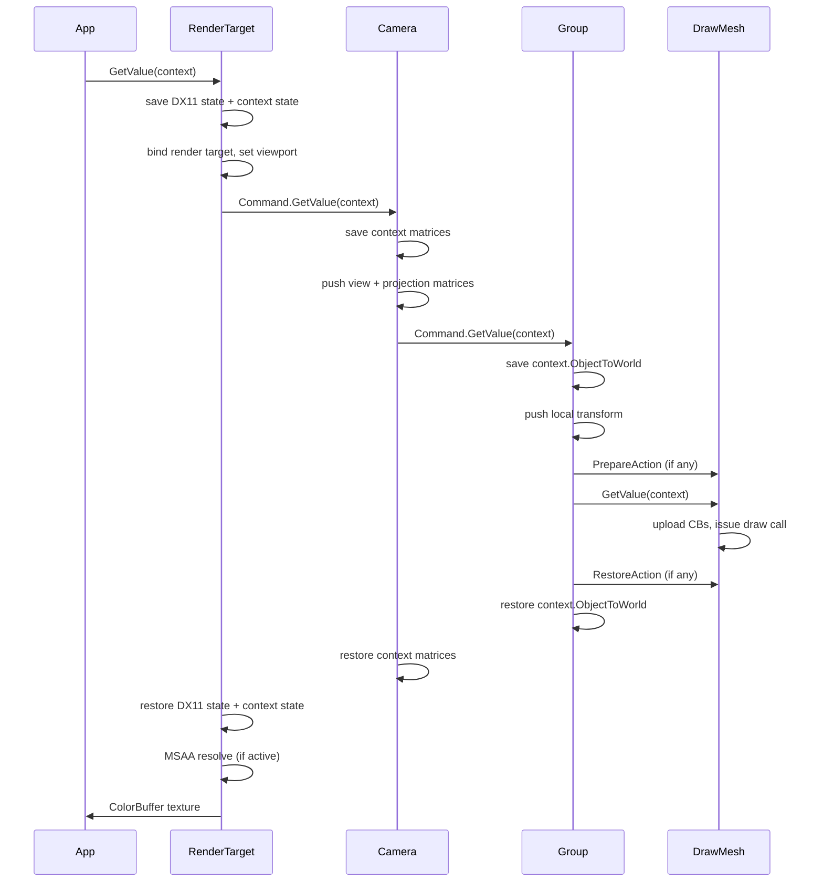

# tixl Rendering Pipeline: Overview

Every frame tixl produces starts with the same question: what changed? Rather than redrawing everything unconditionally, tixl's engine walks a directed acyclic graph of operators, checks dirty flags on each output slot, and only re-executes the operators that genuinely need updating. The rendering pipeline is not a fixed sequence of stages hardwired into an engine loop. It is the emergent behaviour of a pull-based evaluation system applied to GPU command emission.

Understanding that distinction is the key to everything that follows. tixl is a visual programming environment, not a game engine. Users wire together nodes — each an operator — and the system evaluates that graph on demand. Rendering is not special; it is simply what happens when the evaluated value of a slot happens to be a `Command`, a tiny object whose entire job is to carry two action delegates: one to mutate GPU state, one to restore it.

This document traces the pipeline from the singleton GPU device, through the evaluation context that threads rendering state down the graph, to the concrete operators that position cameras, manage lights, and issue draw calls. The goal is to build an accurate mental model of how tixl achieves composable, stateful GPU rendering without a retained scene graph.

## The Problem tixl Solves

Most creative coding frameworks give you an immediate-mode API: clear, draw, draw, draw, present. That works, but it couples rendering order to code execution order and makes it difficult to compose reusable rendering sub-graphs with consistent state. Three.js took the opposite approach with a retained scene graph: you mutate objects, the renderer traverses the graph at presentation time, and state is implicit in the tree.

tixl needed something different. It is a node-based visual programming environment, which means users construct programs by wiring together operator nodes in a graph editor. The rendering pipeline must be composable, because any operator can be embedded inside any other. It must be lazy, because re-evaluating expensive GPU operations every frame when nothing changed is wasteful. It must also be safe with respect to GPU state, because operators that change blending or depth-stencil settings should not silently corrupt the state expected by neighbouring operators. The command pattern — PrepareAction and RestoreAction — is the answer to that last constraint. Cameras use EvaluationContext mutation for the matrix stack. The two mechanisms are complementary, not competing.

## The Device Is a Static Singleton

Before any rendering can happen, tixl needs a DirectX 11 device and an immediate context. Rather than passing these objects through every call site, `ResourceManager` exposes them as a static property:

```csharp
// Core/Resource/ResourceManager.Graphics.cs
public static partial class ResourceManager
{
    public static Device Device { get; private set; } = null!;

    public static void Init(Device device)
    {
        Device = device;
        var samplerDesc = new SamplerStateDescription
        {
            Filter = Filter.MinMagMipLinear,
            AddressU = TextureAddressMode.Clamp,
            // ...
        };
        DefaultSamplerState = new SamplerState(device, samplerDesc);
    }

    public static SamplerState DefaultSamplerState { get; private set; } = null!;
}
```

`Init` is called once at application startup. After that, every operator anywhere in the graph can reach the device and the immediate context via `ResourceManager.Device` and `ResourceManager.Device.ImmediateContext`. The design trades testability for simplicity: there is exactly one device and one immediate context, and everyone knows where to find them.

The immediate context is important because DX11 separates the context into an "immediate" context for single-threaded rendering and optional "deferred" contexts for multi-threaded recording. tixl uses only the immediate context, which means all GPU calls happen on one thread. State set by one operator is visible to the next one — which is exactly why RestoreAction exists.

## EvaluationContext: The Rendering Thread's Backpack

Think of `EvaluationContext` as the backpack a courier carries through a neighbourhood delivering packages. Every operator gets the same backpack, reads what it needs from it, may put something in or take something out, and eventually hands it to the next operator. The backpack holds every piece of shared rendering state that operators need to coordinate without explicit connections between them.

The full set of fields in `EvaluationContext` breaks into several categories:

```csharp
// Core/Operator/EvaluationContext.cs
public sealed class EvaluationContext
{
    // ── Timing ──────────────────────────────────────────────────────────────
    public double LocalTime { get; set; }
    public double LocalFxTime { get; set; }

    // ── Resolution ──────────────────────────────────────────────────────────
    public Int2 RequestedResolution { get; set; }

    // ── Transform matrices ──────────────────────────────────────────────────
    public Matrix4x4 CameraToClipSpace { get; set; } = Matrix4x4.Identity;
    public Matrix4x4 WorldToCamera    { get; set; } = Matrix4x4.Identity;
    public Matrix4x4 ObjectToWorld    { get; set; } = Matrix4x4.Identity;

    // ── Lighting ────────────────────────────────────────────────────────────
    public PointLightStack PointLights { get; } = new();

    // ── Materials ───────────────────────────────────────────────────────────
    public PbrMaterial PbrMaterial { get; set; }
    public List<PbrMaterial> Materials { get; set; } = new(8);

    // ── Atmosphere ──────────────────────────────────────────────────────────
    public Buffer FogParameters { get; set; } = FogSettings.DefaultSettingsBuffer;
    public System.Numerics.Vector4 BackgroundColor { get; set; }
    public System.Numerics.Vector4 ForegroundColor { get; set; }

    // ── Typed variables (dynamic context namespace) ──────────────────────────
    public Dictionary<string, float>  FloatVariables  { get; } = new();
    public Dictionary<string, bool>   BoolVariables   { get; } = new();
    public Dictionary<string, int>    IntVariables    { get; } = new();
    public Dictionary<string, object> ObjectVariables { get; } = new();
    public Dictionary<string, string> StringVariables { get; } = new();

    // ── Texture slot system ─────────────────────────────────────────────────
    public Dictionary<string, Texture2D> ContextTextures { get; set; } = new(10);
}
```

The three transform matrices form the conventional 3D pipeline stack: `ObjectToWorld` accumulates hierarchical transforms from the Group operator; `WorldToCamera` comes from whichever camera operator is active; `CameraToClipSpace` is the perspective or orthographic projection matrix. Shaders read these via constant buffers that operators upload before each draw call.

`PointLights` is not a simple list. It is a `PointLightStack` — a small class that maintains up to eight point lights, lazily serialises them into a GPU constant buffer only when the set changes, and provides a fallback two-light default when the scene has no explicit lights:

```csharp
// Core/Rendering/PointLightStack.cs
public class PointLightStack
{
    public const int MaxPointLights = 8;

    public Buffer ConstBuffer
    {
        get
        {
            if (_currentSize == 0)
                return GetDefaultBuffer();   // two warm/cool key lights

            if (_isConstBufferDirty)
            {
                UpdateConstBuffer(ref _pointLights, ref _constBuffer, _currentSize);
                _isConstBufferDirty = false;
            }
            return _constBuffer;
        }
    }

    public bool Push(PointLight pointLight) { /* adds, marks dirty */ }
    public void Pop()                       { /* removes, marks dirty */ }
    public void Clear()                     { _currentSize = 0; _isConstBufferDirty = true; }
}
```

The lazy serialisation is a pattern tixl repeats across several subsystems: compute the CPU representation eagerly, push it to the GPU only when something asks for it.

## Dirty Flags and Pull-Based Evaluation

Before tracing how rendering operators execute, it helps to understand how tixl decides whether to execute them at all. The slot system uses integer counters rather than boolean flags, which allows the system to detect re-invalidation within the same frame without extra bookkeeping:

```csharp
// Core/Operator/Slots/DirtyFlag.cs
public sealed class DirtyFlag
{
    public bool IsDirty => TriggerIsEnabled || Reference != Target;

    public int Invalidate()
    {
        if (InvalidationRefFrame != InvalidatedWithRefFrame)
        {
            InvalidatedWithRefFrame = InvalidationRefFrame;
            Target++;
        }
        return Target;
    }

    public void Clear() { Reference = Target; }

    public int Reference;
    public int Target = 1;  // starts dirty
}
```

`Target` increments when a slot is invalidated; `Reference` is updated to match `Target` when the slot is evaluated. `IsDirty` is the simple comparison `Reference != Target`. The `InvalidationRefFrame` counter prevents a slot connected to multiple upstream nodes from being counted as dirty more than once per frame, even if two different paths lead to the same slot.

The `Slot<T>.GetValue` method wraps this:

```csharp
// Core/Operator/Slots/Slot.cs
public T? GetValue(EvaluationContext context)
{
    Update(context);
    return Value;
}

public void Update(EvaluationContext context)
{
    if (_dirtyFlag.IsDirty || _valueIsCommand)
    {
        UpdateAction?.Invoke(context);
        _dirtyFlag.Clear();
    }
}
```

The `_valueIsCommand` special-case is the critical detail for rendering. Because `Command` values carry mutable action delegates and GPU state change is their purpose, Command slots always re-evaluate. Every other slot type re-evaluates only when dirty. This is why modifying an upstream parameter triggers re-rendering exactly as far downstream as the dirty flag propagates, and no further.

## Command: The Atom of GPU State Change

```csharp
// Core/DataTypes/Command.cs
public class Command
{
    public Action<EvaluationContext> PrepareAction { get; init; }
    public Action<EvaluationContext> RestoreAction { get; set; }
}
```

This is the entire definition of `Command`. Two delegates, nothing else. The PrepareAction mutates GPU state. The RestoreAction puts it back. Operators that change GPU state — shader programs, render targets, rasterizer settings — store a `Command` as the value of their output slot and attach their save/restore logic to these delegates.

Crucially, PrepareAction and RestoreAction are not called by the slot system itself. They are called by container operators — primarily `Group` — which knows it is iterating over a set of child commands and takes responsibility for bracketing each one:

```csharp
// Operators/Lib/Symbols/render/transform/Group.cs
private void Update(EvaluationContext context)
{
    // ... build transform matrix, multiply into context.ObjectToWorld ...

    var commands = Commands.CollectedInputs;
    foreach (var t1 in commands)
    {
        t1.Value?.PrepareAction?.Invoke(context);   // bracket open
        t1.GetValue(context);                        // draw
        t1.Value?.RestoreAction?.Invoke(context);    // bracket close
    }
}
```

This is where the analogy becomes concrete. The PrepareAction/RestoreAction pattern is like a context manager or RAII guard at the GPU level. A Group operator is a scope. Any GPU state changes applied by children of that Group are rolled back before the next sibling begins. The order of operations within a single `Group.Update` call is deterministic and safe regardless of how deeply operators are nested.

## Camera Operators: Context Mutation as Matrix Stack

Camera operators use a different mechanism from Command state management. Rather than emitting a Command with PrepareAction and RestoreAction, they directly mutate the EvaluationContext transform matrices, evaluate their child command tree, and then restore the matrices. The pattern is identical in spirit but expressed as direct mutation rather than delegate dispatch.

Here is the `Camera` operator doing this:

```csharp
// Operators/Lib/Symbols/render/camera/Camera.cs
private void UpdateOutputWithSubtree(EvaluationContext context)
{
    if (!Reference.HasInputConnections || Reference.DirtyFlag.IsDirty)
        UpdateCameraDefinition(context);

    Reference.DirtyFlag.Clear();

    if (context.BypassCameras)
    {
        Command.GetValue(context);  // bypass: skip camera setup
        return;
    }

    // Save
    var prevWorldToCamera    = context.WorldToCamera;
    var prevCameraToClipSpace = context.CameraToClipSpace;

    // Mutate
    context.WorldToCamera    = WorldToCamera;
    context.CameraToClipSpace = CameraToClipSpace;

    // Evaluate children
    Command.GetValue(context);

    // Restore
    context.CameraToClipSpace = prevCameraToClipSpace;
    context.WorldToCamera     = prevWorldToCamera;
}
```

`UpdateCameraDefinition` constructs the view and projection matrices from the operator's input slots (position, target, FOV, aspect ratio, clip planes) and stores them on the Camera instance. `UpdateOutputWithSubtree` then pushes those matrices into the EvaluationContext, evaluates the child tree (which will use the matrices), and pops them.

The `BypassCameras` flag on EvaluationContext lets the editor's viewport override camera operators entirely and substitute the editor's own view. When `BypassCameras` is true, the camera operator becomes transparent: it evaluates the child tree using whatever matrices the editor already put in the context.

The `OrbitCamera` demonstrates how animated cameras work. Its output slot declares `DirtyFlagTrigger = DirtyFlagTrigger.Animated`, which causes the slot system to treat it as always dirty during playback:

```csharp
// Operators/Lib/Symbols/render/camera/OrbitCamera.cs
[Output(Guid = "14a63b62...", DirtyFlagTrigger = DirtyFlagTrigger.Animated)]
public readonly Slot<Command> Output = new();
```

This is how tixl reconciles pull-based evaluation with real-time animation: most operators re-evaluate only when their inputs change, but operators that animate independently declare themselves as continuously dirty, forcing re-evaluation every frame.

## Resolution Flow Through the Graph

Resolution does not flow upward from a render surface. It flows downward from a RenderTarget operator through the EvaluationContext. When a RenderTarget evaluates, it reads its own `Resolution` input slot, falls back to the inherited `context.RequestedResolution` if that slot is zero, then pushes the concrete size down to all children:

```csharp
// Operators/Lib/Symbols/image/generate/basic/RenderTarget.cs (simplified)
private void Update(EvaluationContext context)
{
    var size = Resolution.GetValue(context);

    if (size.Width == 0 || size.Height == 0)
        size = context.RequestedResolution;  // inherit from parent context

    // ... allocate textures at `size` ...

    var prevRequestedResolution = context.RequestedResolution;
    context.RequestedResolution = size;       // push down to children

    Command.GetValue(context);                // evaluate child scene

    context.RequestedResolution = prevRequestedResolution; // restore
}
```

This is elegant because any operator that needs to make a resolution-dependent decision — computing an aspect ratio for a camera, allocating an intermediate buffer — can simply read `context.RequestedResolution` and trust that it reflects the resolution of the nearest enclosing RenderTarget.

A camera operator reading the aspect ratio demonstrates this dependency:

```csharp
// Camera.cs
var aspectRatio = AspectRatio.GetValue(context);
if (aspectRatio < 0.0001f)
{
    aspectRatio = (float)context.RequestedResolution.Width
                / context.RequestedResolution.Height;
}
```

If the user has not set an explicit aspect ratio, the camera derives one from the enclosing render target's resolution. The graph is self-consistent: changing a RenderTarget's resolution automatically propagates the correct aspect ratio to any camera in its subtree.

## Material State and PBR Context

The `EvaluationContext` also threads PBR material state through the graph. `DrawScene` illustrates how an operator can select a specific material from the list by name, set it on the context, evaluate its children, and restore the previous material:

```csharp
// Operators/Lib/Symbols/render/scene/DrawScene.cs
private void Update(EvaluationContext context)
{
    var previousMaterial = context.PbrMaterial;

    var materialId = UseMaterialId.GetValue(context);
    if (!string.IsNullOrEmpty(materialId))
    {
        foreach (var m in context.Materials)
        {
            if (m.Name != materialId) continue;
            context.PbrMaterial = m;
            break;
        }
    }

    Output.ConnectedUpdate(context);
    context.PbrMaterial = previousMaterial;  // restore
}
```

`PbrMaterial` itself bundles the four GPU resources a PBR shader needs — albedo, emissive, roughness/metallic/occlusion, and normal map — plus a constant buffer with scalar parameters (base colour, roughness, specular, metalness):

```csharp
// Core/Rendering/Material/PbrMaterial.cs
public class PbrMaterial : IDisposable
{
    public string Name;
    public ShaderResourceView AlbedoMapSrv;
    public ShaderResourceView EmissiveMapSrv;
    public ShaderResourceView RoughnessMetallicOcclusionSrv;
    public ShaderResourceView NormalSrv;
    public PbrParameters Parameters;
    public Buffer ParameterBuffer;

    [StructLayout(LayoutKind.Explicit, Size = Stride)]
    public struct PbrParameters
    {
        [FieldOffset(0)]  public Vector4 BaseColor;
        [FieldOffset(16)] public Vector4 EmissiveColor;
        [FieldOffset(32)] public float Roughness;
        [FieldOffset(36)] public float Specular;
        [FieldOffset(40)] public float Metal;
        // one float padding
        public const int Stride = 48;
    }
}
```

`PbrContextSettings.SetDefaultToContext` is called during `EvaluationContext.Reset()` to ensure sane defaults: a white albedo, no emission, roughness 0.5, metalness 0. It also populates `context.ContextTextures["PrefilteredSpecular"]` with the IBL prefiltered specular map, making it available to any shader that needs it without an explicit connection in the node graph.

## PBR Fog Settings

Fog in tixl is a constant buffer attached to the EvaluationContext. Shaders that support atmospheric fog read the buffer at a well-known slot. The buffer is never null; `FogSettings.DefaultSettingsBuffer` provides fallback parameters with a very large `Distance` (10,000 units) and black colour — effectively invisible fog:

```csharp
// Core/Rendering/FogSettings.cs
[StructLayout(LayoutKind.Explicit, Size = 32)]
public struct FogParameters
{
    [FieldOffset(0)]  public Vector4 Color;
    [FieldOffset(16)] public float Distance;
    [FieldOffset(20)] public float Bias;
}
```

A `SetFog` operator replaces the buffer on the context, evaluates its children under the new atmosphere, then restores the previous buffer. The pattern is identical to material swapping: mutate context, evaluate subtree, restore context.

## State Save/Restore: The OutputMergerStage Example

For GPU state that cannot be represented as context fields — render target bindings, viewport dimensions, blend states, depth-stencil states, rasterizer states — tixl uses the Command pattern explicitly. `OutputMergerStage` is a clean example:

```csharp
// Operators/Lib/Symbols/render/_dx11/api/OutputMergerStage.cs
public OutputMergerStage()
{
    Output.UpdateAction += Update;
    Output.Value.RestoreAction = Restore;   // set on the Command object
}

private void Update(EvaluationContext context)
{
    var outputMerger = ResourceManager.Device.ImmediateContext.OutputMerger;

    // Read desired state from connected input slots
    _depthStencilView = DepthStencilView.GetValue(context);
    RenderTargetViews.GetValues(ref _renderTargetViews, context);

    // Save current state
    _prevRenderTargetViews = outputMerger.GetRenderTargets(_renderTargetViews.Length);
    outputMerger.GetRenderTargets(out _prevDepthStencilView);
    _prevBlendState = outputMerger.GetBlendState(out _prevBlendFactor, out _prevSampleMask);

    // Apply new state
    outputMerger.SetDepthStencilState(DepthStencilState.GetValue(context));
    outputMerger.SetTargets(_depthStencilView, _renderTargetViews);
    outputMerger.BlendState = BlendState.GetValue(context);
}

private void Restore(EvaluationContext context)
{
    var outputMerger = ResourceManager.Device.ImmediateContext.OutputMerger;
    outputMerger.SetBlendState(_prevBlendState, _prevBlendFactor, _prevSampleMask);
    outputMerger.SetRenderTargets(_prevDepthStencilView, _prevRenderTargetViews);
    // clean up COM reference counts
    foreach (var rtv in _prevRenderTargetViews) rtv?.Dispose();
    _prevBlendState = null;
}
```

Notice that `Restore` is wired to `Output.Value.RestoreAction`, not to `UpdateAction`. The `Command` object holds both delegates, and the container (`Group`) calls them in sequence: `PrepareAction`, `GetValue` (which triggers `UpdateAction`), `RestoreAction`. This means the "prepare" step in the Command pattern is separate from the "update" step: UpdateAction is what runs during graph evaluation; PrepareAction is an optional additional action the container calls before evaluation.

The `Rasterizer` operator follows the same pattern but for viewport and rasterizer state:

```csharp
// Operators/Lib/Symbols/render/_dx11/api/Rasterizer.cs
private void Update(EvaluationContext context)
{
    var rasterizer = ResourceManager.Device.ImmediateContext.Rasterizer;
    _prevViewports = rasterizer.GetViewports<RawViewportF>();
    _prevState = rasterizer.State;

    rasterizer.State = RasterizerState.GetValue(context);
    if (_viewports.Length > 0)
        rasterizer.SetViewports(_viewports, _viewports.Length);
}

private void Restore(EvaluationContext context)
{
    var rasterizer = ResourceManager.Device.ImmediateContext.Rasterizer;
    rasterizer.SetViewports(_prevViewports, _prevViewports.Length);
    rasterizer.State = _prevState;
}
```

## Evaluation Flow: A Concrete Trace

To make the abstract concrete, trace what happens when tixl evaluates a minimal scene: `RenderTarget → Camera → Group → [DrawMesh]`.

1. The application calls `GetValue(context)` on the `RenderTarget` output slot.
2. `RenderTarget.Update` fires. It resolves `size` (explicit or inherited from context), allocates DX11 textures if needed, saves DX11 render target bindings and viewport, pushes the new render target and viewport to DX11, saves EvaluationContext state (matrices, resolution, colours), sets the context resolution, calls `SetDefaultCamera` to initialise matrices.
3. `RenderTarget.Update` calls `Command.GetValue(context)` — this triggers the child graph.
4. The `Camera` output slot evaluates. `Camera.UpdateOutputWithSubtree` fires. It saves `prevWorldToCamera` and `prevCameraToClipSpace`, pushes the camera's own view and projection matrices into the context, then calls `Command.GetValue(context)`.
5. The `Group` output slot evaluates. `Group.Update` fires. It computes the group's local transform matrix, multiplies it into `context.ObjectToWorld`, iterates over child commands:
   - Calls `PrepareAction` if present.
   - Calls `GetValue(context)` on the child.
   - Calls `RestoreAction` if present.
6. Each child draw operator (DrawMesh, DrawScene, etc.) reads `context.ObjectToWorld`, `context.WorldToCamera`, `context.CameraToClipSpace`, `context.PbrMaterial`, `context.PointLights.ConstBuffer`, uploads constant buffers, issues a DX11 draw call.
7. After all children complete, `Group.Update` restores `context.ObjectToWorld` and `context.ForegroundColor`.
8. After the child command returns, `Camera.UpdateOutputWithSubtree` restores `prevWorldToCamera` and `prevCameraToClipSpace`.
9. `RenderTarget.Update` resumes, restores DX11 render target bindings and viewport, restores EvaluationContext state, resolves MSAA if active, generates mipmaps if requested.
10. The output texture is now in `ColorBuffer.Value`, ready for downstream operators or display.



## Comparison: Command Pattern vs. Other Approaches

Understanding what tixl chose requires knowing what it did not choose.

| Aspect | tixl (Command + Context) | OpenFrameworks (Immediate) | three.js (Retained Scene) |
|---|---|---|---|
| State management | Explicit save/restore per operator | Global GL state machine | Implicit in scene tree |
| Render order | Determined by operator graph evaluation | Determined by draw call sequence | Determined by renderer traversal |
| Composability | High — any subgraph embeds anywhere | Low — must manually save/restore | Medium — subtrees via Object3D |
| Re-render strategy | Pull-based with dirty flags | Every frame, unconditionally | Every frame, or selective via .needsUpdate |
| Camera system | Context mutation with scope | ofCamera push/pop matrix stack | scene.camera reference |
| Custom GPU state | RestoreAction per operator | glPush/glPopAttrib equivalent | Three.Material properties |
| Multi-target | Multiple RenderTarget nodes | ofFbo push/pop | WebGLRenderTarget |

The key tradeoff in tixl's design: every stateful operator must implement its own save/restore logic correctly. There is no framework-level guarantee that GPU state is clean between operators. The convention is enforced by Group calling PrepareAction/RestoreAction, but operators that manage state outside of Command (like RenderTarget managing its own context save/restore inline) must do so correctly themselves. This means bugs in one operator's restore logic can corrupt the state seen by sibling operators in the same Group.

The advantage is expressive power. Because state save/restore is local to each operator, users can nest RenderTargets inside Groups inside other RenderTargets, with different cameras and lighting at each level, and the system composes correctly as long as each operator restores what it saves.

## Implications for Rust Framework Design

Several patterns from tixl's rendering pipeline are worth carrying forward.

The separation between `EvaluationContext` (CPU-side rendering state) and explicit DX11 save/restore (GPU-side rendering state) maps cleanly to wgpu's model. In wgpu, GPU commands are recorded into a `CommandEncoder`, so there is no mutable global GPU state to save and restore. The EvaluationContext pattern — threading rendering state through an evaluation call — translates directly: a Rust evaluation function would receive a `&mut EvalContext` containing matrices, lights, materials, and a `&mut wgpu::CommandEncoder` for recording GPU commands.

The dirty flag system using integer counters rather than booleans is an elegant optimisation worth replicating. The key insight is that `InvalidationRefFrame` prevents double-counting within a frame without requiring a pass to reset flags before evaluation.

The `PointLightStack` pattern — maintain CPU state, serialise to GPU buffer lazily — is directly applicable to any shader resource that changes infrequently. In Rust, this could be a struct with a `dirty: bool` field and a method that returns a `&wgpu::Buffer`, uploading via `queue.write_buffer` only when dirty.

The Camera pattern of temporarily scoping matrices is essentially a push/pop matrix stack implemented through function call scope rather than an explicit stack data structure. Rust's ownership system makes this pattern even more natural: a `CameraScope` struct could hold the previous matrices and restore them in its `Drop` implementation, eliminating the possibility of forgetting to restore.

## References

- `Core/DataTypes/Command.cs` — Command definition (PrepareAction, RestoreAction)
- `Core/Operator/EvaluationContext.cs` — Full rendering context fields
- `Core/Operator/Slots/DirtyFlag.cs` — Dirty flag counter mechanism
- `Core/Operator/Slots/Slot.cs` — GetValue, Update, Invalidate logic
- `Core/Resource/ResourceManager.Graphics.cs` — Device singleton, Init, buffer helpers
- `Core/Rendering/PointLightStack.cs` — Light stack with lazy GPU serialisation
- `Core/Rendering/FogSettings.cs` — Fog parameter buffer
- `Core/Rendering/Material/PbrMaterial.cs` — PBR material GPU resource bundle
- `Core/Rendering/Material/PbrContextSettings.cs` — Default material setup, IBL textures
- `Operators/Lib/Symbols/render/camera/Camera.cs` — View/projection matrix scoping
- `Operators/Lib/Symbols/render/camera/OrbitCamera.cs` — Animated camera, DirtyFlagTrigger.Animated
- `Operators/Lib/Symbols/render/transform/Group.cs` — PrepareAction/RestoreAction invocation
- `Operators/Lib/Symbols/render/scene/DrawScene.cs` — Material selection via context
- `Operators/Lib/Symbols/render/_dx11/api/OutputMergerStage.cs` — GPU blend/RT state save-restore
- `Operators/Lib/Symbols/render/_dx11/api/Rasterizer.cs` — Viewport/rasterizer state save-restore
- `Operators/Lib/Symbols/render/_dx11/fxsetup/SetPixelAndVertexShaderStage.cs` — Shader stage save-restore
- `Operators/Lib/Symbols/image/generate/basic/RenderTarget.cs` — Full render target lifecycle
