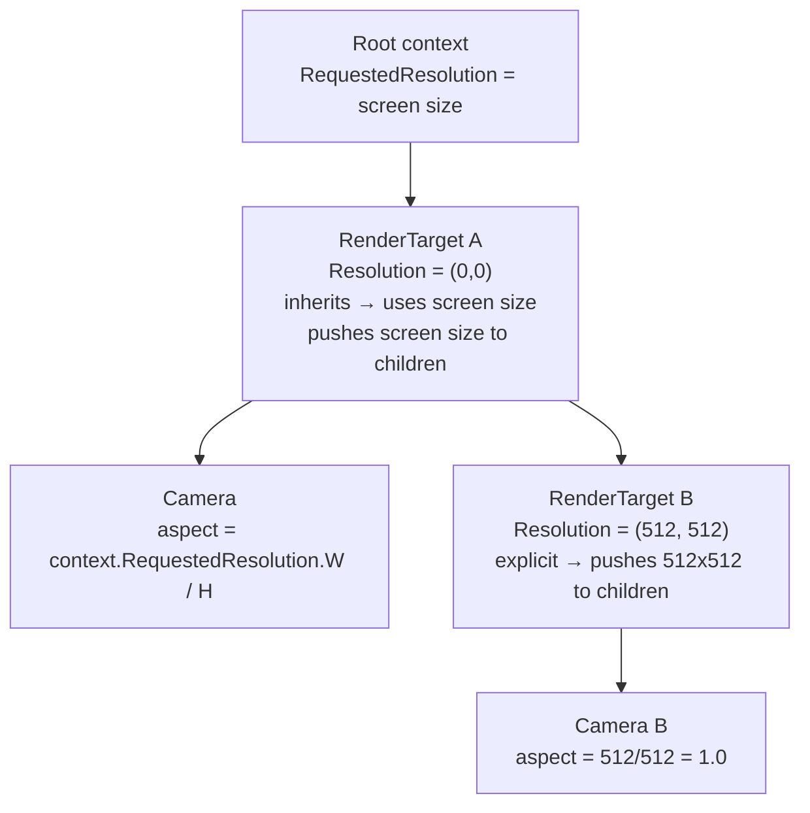

# tixl RenderTarget: Composable Framebuffers in the Node Graph

Composing effects in a node graph requires the ability to draw into an offscreen surface, treat the result as a texture, and feed it into another operator. In tixl, that ability comes from a single operator: `RenderTarget`. What makes tixl's design interesting is not that it has render-to-texture — every serious graphics system does — but how the operator fits into the pull-based evaluation model, manages MSAA resolve, and handles the interaction between node-graph composability and DirectX 11's stateful immediate context.

The analogy that makes `RenderTarget` click is a photographic darkroom. The room has its own lighting, its own chemical baths, and its own enlarger. You set it up, run your process, and everything that happened inside stays inside. From the outside, you only see the developed print. `RenderTarget` is that darkroom: it creates an isolated rendering environment, runs a child graph inside it, and exposes the output as a texture. The DX11 state before the darkroom door opened is exactly what you find when you leave.

This document covers the full lifecycle of a `RenderTarget`: how it allocates textures, how it saves and restores the surrounding DX11 and EvaluationContext state, how MSAA changes the buffer layout, how the depth buffer is resolved differently from the colour buffer, and what the texture format choices mean for downstream operators.

## The Problem: Stateful GPU Context in a Composable Graph

DirectX 11's immediate context is a global state machine. When an operator binds a render target, sets a viewport, and issues draw calls, those settings persist until explicitly overwritten. If a `RenderTarget` operator simply bound its textures, ran the child graph, and returned, the DX11 context would be left in the state the children left it — a different render target, a different viewport, possibly a different blend state. Any rendering that happened after the `RenderTarget` in the graph would be corrupted.

The problem is structurally identical to what the Command pattern (PrepareAction/RestoreAction) solves for shader state — but `RenderTarget` manages a larger surface area of DX11 state, and it does so inline in its `Update` method rather than by emitting a Command object with delegates. The reason is that RenderTarget is not a passive Command emitter; it is an active operator that drives child evaluation and owns its own texture lifetime.

## Texture Topology: Two Buffers or Four

When you instantiate a `RenderTarget` node, what you get in memory depends on the options you choose. The simplest case — LDR colour, no depth, no MSAA — allocates a single DX11 `Texture2D`. The most complex case — HDR colour, depth, normals, and 8x MSAA — allocates six textures. Understanding the layout explains the MSAA resolve step.

When MSAA is disabled (`_sampleCount == 1`), there is a one-to-one correspondence between logical buffers and physical textures:

```
_multiSampledColorBuffer  → used directly as output (no "resolve" needed)
_multiSampledDepthBuffer  → used directly as output
_multiSampledNormalBuffer → used directly as output
```

When MSAA is enabled (`_sampleCount > 1`), each buffer gets a multisampled texture for rendering and a single-sample texture for the resolved output:

```
_multiSampledColorBuffer   → DX11 renders into this (sampleCount samples per pixel)
_resolvedColorBuffer       → DX11 ResolveSubresource writes the resolved result here

_multiSampledDepthBuffer   → DX11 renders depth into this
_resolvedDepthBuffer       → Compute shader resolves depth into this (R32_Float UAV)

_multiSampledNormalBuffer  → DX11 renders normals into this
_resolvedNormalBuffer      → DX11 ResolveSubresource writes resolved normals here
```

The naming is slightly confusing: `_multiSampledColorBuffer` exists in both the MSAA and non-MSAA paths, but in the non-MSAA path `DownSamplingRequired` is false, so it is treated as a single-sample texture. The `DownSamplingRequired` property codifies this:

```csharp
// Operators/Lib/Symbols/image/generate/basic/RenderTarget.cs
private bool DownSamplingRequired => _sampleCount > 1;
```

The output slots read the correct texture depending on whether MSAA is active:

```csharp
private Texture2D ColorTexture  => _sampleCount > 1 ? _resolvedColorBuffer  : _multiSampledColorBuffer;
private Texture2D DepthTexture  => _sampleCount > 1 ? _resolvedDepthBuffer   : _multiSampledDepthBuffer;
private Texture2D NormalTexture => _sampleCount > 1 ? _resolvedNormalBuffer  : _multiSampledNormalBuffer;
```

This means downstream operators that read `ColorBuffer`, `DepthBuffer`, or `NormalBuffer` always receive a single-sample texture with no knowledge of whether MSAA was used. The resolve step is transparent.

## Three Output Slots

`RenderTarget` exposes three typed output slots:

```csharp
[Output(Guid = "7A4C4FEB-BE2F-463E-96C6-CD9A6BAD77A2")]
public readonly Slot<Texture2D> ColorBuffer = new();

[Output(Guid = "8bb0b18f-4fad-4348-a4fa-95b40c4167a4")]
public readonly Slot<Texture2D> DepthBuffer = new();

[Output(Guid = "1CAEFB48-D7FB-40C1-B5B5-C2CF5837DFA9")]
public readonly Slot<Texture2D> NormalBuffer = new();
```

All three trigger the same `Update` method — any downstream operator requesting any of these outputs will trigger the full render pass. This is by design: a single render pass populates all three buffers simultaneously, so it would be wasteful to perform separate render passes for colour and depth. The dirty flag system ensures `Update` runs at most once per frame regardless of how many downstream operators read these outputs.

The normal buffer is optional. It is only allocated when `WithNormalBuffer` is true, and it always uses `R16G16B16A16_Float` format:

```csharp
// from UpdateTextures
_multiSampledNormalBuffer = Texture2D.CreateTexture2D(
    new Texture2DDescription
    {
        Format = Format.R16G16B16A16_Float,   // fixed — normals need signed float range
        // ...
    });
```

The colour buffer format is user-configurable via the `TextureFormat` input slot, with a safeguard against `Format.Unknown`:

```csharp
var textureFormat = TextureFormat.GetValue(context);
if (textureFormat == Format.Unknown)
{
    Log.Warning("Texture format unknown is not supported. Falling back to default", this);
    textureFormat = TextureFormat.TypedDefaultValue.Value;
    TextureFormat.SetTypedInputValue(textureFormat);
}
```

## Texture Format Selection

The choice of texture format determines colour precision, memory footprint, and what downstream processing is possible. tixl's RenderTarget exposes this as a first-class node input rather than a fixed default.

The depth buffer format is not user-configurable — it is always `R32_Typeless` for the DX11 texture, viewed as `D32_Float` through the DepthStencilView and as `R32_Float` through the ShaderResourceView. This format supports both depth testing (DSV) and reading in shaders (SRV), which is necessary for effects like soft particles, depth-of-field, and screen-space ambient occlusion.

Common colour formats and their use cases:

| Format | Bits per channel | Range | Use case |
|---|---|---|---|
| `R8G8B8A8_UNorm` | 8 | [0, 1] | Standard LDR colour, UI, thumbnails |
| `R16G16B16A16_Float` | 16 | [-65504, 65504] | HDR rendering, tonemapping source |
| `R32G32B32A32_Float` | 32 | full float | Scientific computation, GPU simulations |
| `R11G11B10_Float` | 11/11/10 | positive only | HDR without alpha, compact |
| `R16G16B16A16_Float` | 16 | signed | Normal buffer (always this format) |

The depth format choice within RenderTarget is handled by a boolean flag rather than a format enum:

```csharp
var withDepthBuffer = WithDepthBuffer.GetValue(context);

// inside UpdateTextures:
Format depthFormat = withDepthBuffer ? Format.R32_Typeless : Format.Unknown;
```

`Format.Unknown` signals that no depth buffer should be allocated. The `R32_Typeless` format is a DX11 idiom: the texture itself is typeless, but views over it interpret the bits as `D32_Float` (DSV for depth testing) or `R32_Float` (SRV for shader sampling). This dual interpretation is what allows a depth buffer to participate in both the rasterisation pipeline and compute shaders.

## Texture Allocation and Change Detection

Allocating GPU textures is expensive. `RenderTarget` avoids reallocating unless something actually changed — size, format, sample count, or mip count. The check is a multi-field comparison:

```csharp
// Operators/Lib/Symbols/image/generate/basic/RenderTarget.cs
var colorFormatChanged = _multiSampledColorBuffer == null
    || _multiSampledColorBuffer.Description.Format         != colorFormat
    || _multiSampledColorBuffer.Description.MipLevels      != multiSampleTexture2dMipLevels
    || _multiSampledColorBuffer.Description.Width          != size.Width
    || _multiSampledColorBuffer.Description.Height         != size.Height
    || _multiSampledColorBuffer.Description.SampleDescription.Count != _sampleCount;

if (colorFormatChanged)
{
    // Dispose existing textures, views
    Utilities.Dispose(ref _multiSampledColorBufferSrv);
    Utilities.Dispose(ref _multiSampledColorBufferRtv);
    Utilities.Dispose(ref _multiSampledColorBuffer);

    // Create new texture
    _multiSampledColorBuffer = Texture2D.CreateTexture2D(new Texture2DDescription
    {
        ArraySize = 1,
        BindFlags = BindFlags.RenderTarget | BindFlags.ShaderResource,
        Format = colorFormat,
        Width = size.Width,
        Height = size.Height,
        MipLevels = !DownSamplingRequired ? mipLevels : 1,
        OptionFlags = !DownSamplingRequired && generateMips
            ? ResourceOptionFlags.GenerateMipMaps
            : ResourceOptionFlags.None,
        SampleDescription = new SampleDescription(_sampleCount, 0),
        Usage = ResourceUsage.Default,
    });

    _multiSampledColorBufferSrv = new ShaderResourceView(device, _multiSampledColorBuffer);
    _multiSampledColorBufferRtv = new RenderTargetView(device, _multiSampledColorBuffer, ...);
    _wasClearedOnce = false;
}
```

`BindFlags.RenderTarget | BindFlags.ShaderResource` tells DX11 that this texture will be used both as a render target (written by the rasteriser) and as a shader resource (read by pixel shaders). This combination is what makes render-to-texture work: the same GPU allocation is accessible via two different views.

The MSAA sample count maps to a named enum to give node users readable options in the UI:

```csharp
private enum Samples
{
    No_MSAA      = 1,
    MSAA_2Samples = 2,
    MSAA_4Samples = 4,
    MSAA_8Samples = 8,
}
```

When MSAA is active, the RenderTargetView dimension is `Texture2DMultisampled` instead of `Texture2D`. DX11 treats these as distinct types and will reject a view with the wrong dimension for the texture's SampleDescription.

## The Mipmap Consideration

When `GenerateMips` is true, `RenderTarget` computes how many mip levels the texture needs:

```csharp
var w = Math.Max(size.Width, size.Height);
var mipLevels = generateMips ? (int)MathUtils.Log2(w) + 1 : 1;
```

Mipmaps and MSAA are incompatible in DX11: MSAA textures cannot have `GenerateMipMaps` as a resource option. When both are requested, tixl resolves the MSAA into the `_resolvedColorBuffer` first (a single-sample texture), then generates mipmaps on that resolved texture:

```csharp
if (generateMips)
{
    deviceContext.GenerateMips(
        DownSamplingRequired
            ? _resolvedColorBufferSrv  // use resolved (single-sample) for mip gen
            : _multiSampledColorBufferSrv);
}
```

The resolved colour buffer is created with `ResourceOptionFlags.GenerateMipMaps` and `mipLevels` set correctly, so DX11 knows to allocate storage for the full mip chain. The multisampled buffer is always created with `MipLevels = 1`.

## State Save and Restore

The state management inside `RenderTarget.Update` is the most operationally complex part of the operator. It saves two categories of state: DX11 device context state, and EvaluationContext fields. Both must be restored after the child graph finishes.

The DX11 state saved is:

```csharp
var prevViewports = deviceContext.Rasterizer.GetViewports<RawViewportF>();
const int RtCount = 3;
var prevTargets = deviceContext.OutputMerger.GetRenderTargets(RtCount, out var prevDsv);
```

Only three render target slots are captured. This matches the maximum tixl uses internally (colour, depth, normals). Capturing all eight `SimultaneousRenderTargetCount` slots would be wasteful.

The EvaluationContext state saved is:

```csharp
var prevRequestedResolution = context.RequestedResolution;
var prevObjectToWorld       = context.ObjectToWorld;
var prevWorldToCamera       = context.WorldToCamera;
var prevCameraToClipSpace   = context.CameraToClipSpace;
var keepCameraBypass        = context.BypassCameras;
var keepBackgroundColor     = context.BackgroundColor;
var keepForegroundColor     = context.ForegroundColor;
```

After saving, the new state is applied:

```csharp
// DX11 state
deviceContext.Rasterizer.SetViewport(
    new SharpDX.Viewport(0, 0, size.Width, size.Height, 0.0f, 1.0f));

if (withNormalBuffer && _multiSampledNormalBufferRtv != null)
    deviceContext.OutputMerger.SetTargets(
        _multiSampledDepthBufferDsv,
        _multiSampledColorBufferRtv,
        _multiSampledNormalBufferRtv);
else
    deviceContext.OutputMerger.SetTargets(
        _multiSampledDepthBufferDsv,
        _multiSampledColorBufferRtv);

// Context state
context.RequestedResolution = size;
context.BypassCameras = false;
context.BackgroundColor = Vector4.One;
context.ForegroundColor = Vector4.One;
context.SetDefaultCamera();    // initialise matrices to a known-good state
```

Setting `BypassCameras = false` is deliberate: the editor viewport may have set this flag to override camera operators with the editor's own view. An offscreen RenderTarget should not inherit that override — it must always use the scene's actual camera.

Setting `BackgroundColor` and `ForegroundColor` to white is a safe default for a fresh render pass. Operators that need different colours can override these in their own `Update`.

Calling `SetDefaultCamera` initialises the three transform matrices to a canonical perspective view (camera at default distance, looking at origin, standard FOV). This prevents any camera left in the context from a previous evaluation from accidentally affecting the new render pass. Camera operators in the child graph will immediately overwrite these values, but having a safe default prevents garbage output if no camera is present.

## Clearing

The clear step runs when either `Clear` is true or the textures were just allocated (`!_wasClearedOnce`):

```csharp
if (clear || !_wasClearedOnce)
{
    deviceContext.ClearRenderTargetView(
        _multiSampledColorBufferRtv,
        new SharpDX.Color(clearColor.X, clearColor.Y, clearColor.Z, clearColor.W));

    if (_multiSampledNormalBufferRtv != null)
        deviceContext.ClearRenderTargetView(
            _multiSampledNormalBufferRtv,
            new SharpDX.Color(0.0f, 0.0f, 0.0f, 1.0f));  // black normals

    if (_multiSampledDepthBufferDsv != null)
        deviceContext.ClearDepthStencilView(
            _multiSampledDepthBufferDsv,
            DepthStencilClearFlags.Depth, 1.0f, 0);  // far plane

    _wasClearedOnce = true;
}
```

Normal buffers always clear to `(0, 0, 0, 1)`. This represents a neutral normal (no direction) rather than a valid surface normal, which makes it possible for downstream shaders to detect pixels with no geometry and skip lighting calculations. Depth buffers always clear to `1.0f`, which in the right-handed perspective projection used by tixl represents the far clip plane.

Disabling the clear flag is deliberately supported. This allows feedback effects where the previous frame's render remains in the buffer and new geometry is drawn on top of it, accumulating over time. The `_wasClearedOnce` flag ensures that newly allocated textures always get at least one clear pass, even if `Clear` is false, because uninitialized GPU memory would produce undefined visual output.

## MSAA Colour Resolve

When `_sampleCount > 1`, the MSAA render is resolved to a single-sample texture using DX11's built-in resolve:

```csharp
if (_sampleCount > 1)
{
    device.ImmediateContext.ResolveSubresource(
        _multiSampledColorBuffer, 0,
        _resolvedColorBuffer, 0,
        _resolvedColorBuffer.Description.Format);

    if (withDepthBuffer)
        ResolveDepthBuffer();

    if (withNormalBuffer && _multiSampledNormalBuffer != null && _resolvedNormalBuffer != null)
        device.ImmediateContext.ResolveSubresource(
            _multiSampledNormalBuffer, 0,
            _resolvedNormalBuffer, 0,
            _resolvedNormalBuffer.Description.Format);
}
```

`ResolveSubresource` for colour performs an averaging filter across samples, producing a standard antialiased result. Normal buffers use the same API. Depth is different.

## MSAA Depth Resolve: A Compute Shader Approach

Depth buffers cannot be resolved with `ResolveSubresource` when the target format is `R32_Float`. DX11's built-in resolve only works when source and destination have compatible formats, and a typed `D32_Float` depth-stencil view cannot be the source of `ResolveSubresource` targeting an `R32_Float` UAV.

tixl works around this with a compute shader:

```csharp
// Operators/Lib/Symbols/image/generate/basic/RenderTarget.cs
private void ResolveDepthBuffer()
{
    var resolveShader = _resolveComputeShaderResource.Value;
    var deviceContext = ResourceManager.Device.ImmediateContext;
    var csStage = deviceContext.ComputeShader;

    // Save compute shader state
    var prevShader = csStage.Get();
    var prevUavs   = csStage.GetUnorderedAccessViews(0, 1);
    var prevSrvs   = csStage.GetShaderResources(0, 1);

    csStage.Set(resolveShader);
    csStage.SetShaderResource(0, _multiSampledDepthBufferSrv);  // MSAA input
    csStage.SetUnorderedAccessView(0, _resolvedDepthBufferUav, 0); // output

    const int threadNumX = 16, threadNumY = 16;
    var dispatchCountX = (_multiSampledDepthBuffer.Description.Width  / threadNumX) + 1;
    var dispatchCountY = (_multiSampledDepthBuffer.Description.Height / threadNumY) + 1;
    deviceContext.Dispatch(dispatchCountX, dispatchCountY, 1);

    // Restore compute shader state
    csStage.SetUnorderedAccessView(0, prevUavs[0]);
    csStage.SetShaderResource(0, prevSrvs[0]);
    csStage.Set(prevShader);
}
```

The compute shader (`dx11/resolve-multisampled-depth-buffer-cs.hlsl`) reads the multisampled depth texture as an SRV and writes the minimum depth value across samples into the resolved UAV. Minimum depth is the correct resolve strategy: it corresponds to the sample closest to the camera, which is the one that would have passed depth testing. Some implementations use maximum depth for conservative shadow mapping, but tixl's choice of minimum is appropriate for its use case.

Note that `ResolveDepthBuffer` follows the same save/restore discipline as the GPU state operators: it captures the compute shader, UAV, and SRV bindings before setting its own, then restores them exactly. This is another instance of the darkroom principle — the compute pass for depth resolve does not leave the GPU in an unexpected state.

The resolved depth buffer is created with `BindFlags.ShaderResource | BindFlags.UnorderedAccess` and `Format.R32_Float`:

```csharp
_resolvedDepthBuffer = Texture2D.CreateTexture2D(new Texture2DDescription
{
    BindFlags = BindFlags.ShaderResource | BindFlags.UnorderedAccess,
    Format = Format.R32_Float,
    Width = size.Width,
    Height = size.Height,
    MipLevels = mipLevels,
    SampleDescription = new SampleDescription(1, 0),  // single-sample
    Usage = ResourceUsage.Default
});
_resolvedDepthBufferUav = new UnorderedAccessView(device, _resolvedDepthBuffer);
```

The compute shader writes to the UAV; downstream shaders read via an SRV created separately. There is no RTV for the resolved depth buffer — it is never rendered into, only written by compute and read by pixel shaders.

## The Complete MSAA Buffer Inventory

Reading the Dispose method reveals the full set of GPU resources that a maximally-configured RenderTarget manages:

```csharp
// Operators/Lib/Symbols/image/generate/basic/RenderTarget.cs
protected override void Dispose(bool isDisposing)
{
    if (!isDisposing) return;

    // Colour: multisampled
    Utilities.Dispose(ref _multiSampledColorBuffer);
    Utilities.Dispose(ref _multiSampledColorBufferSrv);
    Utilities.Dispose(ref _multiSampledColorBufferRtv);

    // Colour: resolved
    Utilities.Dispose(ref _resolvedColorBuffer);
    Utilities.Dispose(ref _resolvedColorBufferSrv);
    Utilities.Dispose(ref _resolvedColorBufferRtv);

    // Depth: multisampled
    Utilities.Dispose(ref _multiSampledDepthBuffer);
    Utilities.Dispose(ref _multiSampledDepthBufferDsv);
    Utilities.Dispose(ref _multiSampledDepthBufferSrv);

    // Depth: resolved
    Utilities.Dispose(ref _resolvedDepthBuffer);
    Utilities.Dispose(ref _resolvedDepthBufferUav);

    // Normal: resolved
    Utilities.Dispose(ref _resolvedNormalBuffer);
    Utilities.Dispose(ref _resolvedNormalBufferSrv);
    Utilities.Dispose(ref _resolvedNormalBufferRtv);

    // Normal: multisampled
    Utilities.Dispose(ref _multiSampledNormalBuffer);
    Utilities.Dispose(ref _multiSampledNormalBufferRtv);
}
```

That is seventeen COM objects in the worst case (colour SRV+RTV+texture, colour resolved SRV+RTV+texture, depth DSV+SRV+texture, depth resolved UAV+texture, normal RTV+texture, normal resolved SRV+RTV+texture). Each SharpDX COM wrapper needs explicit disposal, and `Utilities.Dispose` sets the reference to null after disposal, making double-disposal safe.

## Operator Inputs: The Public API of RenderTarget

The node-graph user controls `RenderTarget` through its input slots:

```csharp
[Input(Guid = "4da253b7-...")] public readonly InputSlot<Command> Command = new();
[Input(Guid = "03749b41-...")] public readonly InputSlot<Int2>    Resolution = new();
[Input(Guid = "aacafc4d-...")] public readonly InputSlot<bool>    Clear = new();
[Input(Guid = "8bb4a4e5-...")] public readonly InputSlot<Vector4> ClearColor = new();
[Input(Guid = "E882E0F0-...")] public readonly InputSlot<int>     Multisampling = new();
[Input(Guid = "ec46bef4-...")] public readonly InputSlot<Format>  TextureFormat = new();
[Input(Guid = "6EA4F801-...")] public readonly InputSlot<bool>    WithDepthBuffer = new();
[Input(Guid = "3782E42E-...")] public readonly InputSlot<bool>    WithNormalBuffer = new();
[Input(Guid = "f0cf3325-...")] public readonly InputSlot<bool>    GenerateMips = new();
[Input(Guid = "07AD28AD-...")] public readonly InputSlot<RenderTargetReference> TextureReference = new();
[Input(Guid = "ABEBB02B-...")] public readonly InputSlot<bool>    EnableUpdate = new();
```

`EnableUpdate` deserves explanation. It is an override that forces re-evaluation even when the dirty flag system determines nothing changed. This is useful for cases where the operator's inputs are unchanged but the rendered content should update — for example, when the scene contains GPU particles that evolve entirely on the GPU side and never change any CPU-side dirty flag.

`TextureReference` is a bidirectional handle: when a `RenderTargetReference` is connected, the `RenderTarget` writes its output textures into the reference, allowing operators elsewhere in the graph to read from those textures during the current render pass rather than needing to wait for evaluation to complete.

## Render Target Composition: Nesting and Resolution Inheritance

Because `RenderTarget` emits output textures into its output slots, it can be nested arbitrarily. A typical post-processing pipeline might look like:

```
RenderTarget(1920×1080) → Camera → Group → DrawMesh
                                          → DrawMesh
         |
         ↓ ColorBuffer
RenderTarget(1920×1080) → BloomExtract (reads ColorBuffer as input texture)
         |
         ↓ ColorBuffer
RenderTarget(1920×1080) → ToneMap → Composite
```

Each RenderTarget saves and restores the DX11 state around its child graph. The inner RenderTargets see a clean context: their viewport is set to their own dimensions, their matrices are reset to a default camera, their render target bindings point to their own textures.

Resolution inheritance happens automatically when a `RenderTarget` has `Resolution = (0, 0)`:

```csharp
if (size.Width == 0 || size.Height == 0)
    size = context.RequestedResolution;
```

This means a post-processing chain can be declared at the root level with an explicit size, and all inner render targets with zero-sized resolution will inherit that size through the EvaluationContext. Changing the root resolution updates the entire chain.

The `RequestedResolution` field on EvaluationContext flows like this:



## State Restore After Evaluation

After the child graph returns, all state is restored in reverse order:

```csharp
// EvaluationContext restore
context.BypassCameras        = keepCameraBypass;
context.ObjectToWorld        = prevObjectToWorld;
context.WorldToCamera        = prevWorldToCamera;
context.CameraToClipSpace    = prevCameraToClipSpace;
context.RequestedResolution  = prevRequestedResolution;
context.BackgroundColor      = keepBackgroundColor;
context.ForegroundColor      = keepForegroundColor;

// DX11 restore
deviceContext.Rasterizer.SetViewports(prevViewports);
deviceContext.OutputMerger.SetTargets(prevDsv, prevTargets);

// COM reference count cleanup
for (var i = 0; i < prevTargets.Length; i++)
    prevTargets[i]?.Dispose();
prevDsv?.Dispose();
```

The COM reference count cleanup at the end is important. `GetRenderTargets` increments COM reference counts on the returned views. If they are not disposed, those GPU resources leak. tixl disposes the local copies of the saved views after restoring them, because the device context holds its own reference and the local copies are no longer needed.

## Statistics and Performance Visibility

`RenderTarget` implements `IRenderStatsProvider`, allowing the editor to display per-frame metrics:

```csharp
public IEnumerable<(string, int)> GetStats()
{
    yield return ("RenderTargets",   _statsCount);
    yield return ("with MSAA",       _statsCountWithMsaa);
    yield return ("pixels",          _statsCountPixels);
}
```

`_statsCount` increments once per `Update` call that actually renders. `_statsCountPixels` accumulates the total pixel count across all render targets this frame, including depth buffers. `_statsCountWithMsaa` counts how many of those render targets used MSAA. These numbers appear in the editor's performance overlay and help users identify expensive configurations.

## Render-to-Texture Workflows

The combination of outputs and the fact that `RenderTarget` participates in the lazy evaluation system enables several compositing patterns.

For **texture feedback** — where the current frame reads from the previous frame's result — tixl provides `EnableUpdate = false` as the default, with `Clear = false`. The RenderTarget allocates once and keeps its buffers alive across frames. Setting `EnableUpdate = true` for a specific frame triggers a new render pass. This is how animated effect accumulation works: operators mark themselves dirty (via time-based dirty flags), which cascades to the RenderTarget's input slot, which triggers `EnableUpdate` to re-evaluate.

For **shadow maps**, a depth-only RenderTarget is positioned at the light's perspective. `WithDepthBuffer = true`, `WithNormalBuffer = false`, format set to a depth-friendly size. The `DepthBuffer` output is then fed into a shadow-receiving material as a shader resource.

For **deferred rendering passes**, the RenderTarget's three outputs feed a separate composition shader: the normal buffer drives SSAO, the depth buffer drives SSBO or screen-space reflections, the colour buffer provides albedo for the lighting accumulation.

## Implications for Rust Framework Design

The `RenderTarget` design reveals several patterns worth carrying into a Rust/wgpu implementation.

The save/restore discipline — capturing all modified state before modification, restoring after — maps to wgpu's architecture in an interesting way. wgpu's `RenderPass` is already an RAII scope: it borrows the command encoder, records commands, and releases on drop. The equivalent of tixl's RenderTarget would be a Rust function that creates a `RenderPass`, evaluates a closure representing the child scene, drops the `RenderPass` (ending it and returning the encoder), and then presents the texture. There is no need to manually restore GPU state because wgpu's render passes are self-contained command sequences.

The MSAA double-buffer pattern (multisampled for rendering, resolved for output) is directly applicable. wgpu supports MSAA and requires the same resolve step via `resolve_target` in the `RenderPassColorAttachment`. The depth resolve would still require a compute pass, as wgpu also lacks a built-in multisampled depth resolve.

The `BindFlags.RenderTarget | BindFlags.ShaderResource` combination maps to wgpu's `TextureUsages::RENDER_ATTACHMENT | TextureUsages::TEXTURE_BINDING`. The principle is identical: a texture that can be written as a render target and read as a shader resource needs both usage flags at creation time.

The lazy allocation with multi-field change detection is a pattern worth replicating verbatim. Check size, format, sample count, and mip count; reallocate only when any field changes. In Rust, this could be a `TextureConfig` struct with a derived `PartialEq`, and the cached texture alongside it.

## References

- `Operators/Lib/Symbols/image/generate/basic/RenderTarget.cs` — Full operator implementation
- `Core/DataTypes/RenderTargetReference.cs` — Bidirectional handle type
- `Core/Operator/EvaluationContext.cs` — Context fields saved/restored by RenderTarget
- `Core/Resource/ResourceManager.Graphics.cs` — Device singleton, SetupConstBuffer helpers
- `Operators/Lib/Symbols/render/_dx11/api/OutputMergerStage.cs` — OutputMerger save/restore reference
- `Operators/Lib/Symbols/render/_dx11/api/Rasterizer.cs` — Rasterizer state save/restore reference
- `Operators/Lib/Symbols/render/_dx11/fxsetup/SetPixelAndVertexShaderStage.cs` — Shader stage save/restore reference
- `Core/Rendering/DefaultRenderingStates.cs` — Shared rasterizer and sampler state
