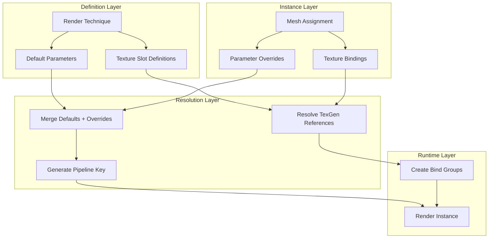

# Material Editor System Porting Guide: Overview

This documentation package provides everything needed to implement the apEx/Phoenix material system in Rust + WGPU. Materials define how meshes render: which shaders to use, what textures to bind, blend modes, depth testing, and parameter animation.

## System Architecture



## Core Concepts

### Render Techniques

A **technique** defines a rendering recipe:
- **Shader** — Which vertex/fragment shaders to use
- **Default parameters** — Base values for all uniforms
- **Texture slots** — What textures the shader expects
- **Pipeline state** — Blend mode, depth mode, cull mode defaults

### Material Instances

A **material instance** assigns a technique to a mesh with overrides:
- **Technique reference** — Which technique to use
- **Parameter overrides** — Values that differ from defaults
- **Texture bindings** — TexGen output → texture slot mappings

### Parameter Types

Phoenix uses a typed union (`MATERIALVALUE`) for parameters:

| Type | Usage |
|------|-------|
| **Float** | Roughness modifiers, UV scale |
| **Color** | Albedo tint, emissive color |
| **ZMode** | Depth test/write configuration |
| **CullMode** | Face culling (front, back, none) |
| **BlendMode** | Src/dst blend factors |
| **Texture** | TexGen output reference |

### Parameter Scope

| Scope | Behavior |
|-------|----------|
| **Constant** | Fixed at material creation, shared across instances |
| **Variable** | Can differ per-instance |
| **Animated** | Driven by timeline splines |

## Resource Estimates

| Resource | Count | Notes |
|----------|-------|-------|
| Render techniques | ~10 | G-Buffer, lighting, post-process, etc. |
| Material instances | ~200 | Per-mesh configurations |
| Parameter types | ~25 | Float, Color, ZMode, Texture0-7, etc. |
| Texture slots | 8 | TEXTURE0-7 |

## Implementation Phases

### Phase 1: Parsing (Data Loading)
**Goal**: Load JSON, decode MATERIALVALUE union

**Documents**: 01-data-structures.md

**Deliverables**:
- [ ] MaterialValue enum with all variants
- [ ] Technique definition parser
- [ ] Instance override parser
- [ ] Texture binding parser

**Milestones**:
1. Parse all 204 material instances
2. Decode every MATERIALVALUE type correctly
3. Build technique → instance relationships

### Phase 2: Resolution (Parameter Merge)
**Goal**: Combine defaults with overrides to produce final values

**Documents**: 02-parameter-merging.md

**Deliverables**:
- [ ] Merge algorithm (defaults + overrides)
- [ ] Type validation (override matches default type)
- [ ] Missing parameter handling (fallback to default)

**Milestones**:
1. Merged parameters match expected output
2. Type mismatches detected and reported
3. Complete parameter set for each instance

### Phase 3: Texture Binding (TexGen Integration)
**Goal**: Connect TexGen outputs to material texture slots

**Documents**: 03-texture-binding.md

**Deliverables**:
- [ ] TexGen output lookup by path/name
- [ ] Slot → texture handle mapping
- [ ] Fallback textures (1×1 white, normal up, etc.)
- [ ] HDR/LDR format matching

**Milestones**:
1. All texture slots resolve to valid handles
2. Missing textures use appropriate fallbacks
3. Format matches shader expectations

### Phase 4: Pipeline Integration (Rendering)
**Goal**: Generate wgpu pipelines and render correctly

**Documents**: 04-pipeline-generation.md

**Deliverables**:
- [ ] PipelineKey from material parameters
- [ ] Blend state generation
- [ ] Depth/stencil state generation
- [ ] Cull mode handling
- [ ] Bind group creation

**Milestones**:
1. Blend modes render correctly (alpha, additive, multiply)
2. Depth testing matches Phoenix behavior
3. Culling works for two-sided materials
4. All 204 instances render visually correct

## Verification Strategy

### Unit Tests
- Decode each MATERIALVALUE type variant
- Parameter merge logic with edge cases
- Pipeline key generation determinism

### Integration Tests
- Full technique → instance → resolved material flow
- Texture binding with real TexGen outputs
- Render comparison against Phoenix reference

### Visual Tests
- Side-by-side renders of complex materials
- Blend mode correctness (additive glow, alpha blending)
- Two-sided rendering (double-sided foliage)

## Critical Source Files

| Path | Content |
|------|---------|
| `notes/per-demoscene/apex-public/rendering/materials.md` | Comprehensive material system documentation |
| `reproduction/scenes/*.json` | Per-scene material assignments |
| `extracted/material_instances.json` | All 204 instances (if extracted) |
| `plans/rust-port-pbr/01-data-structures.md` | Bind group layouts for integration |

## Dependency on TexGen System

Materials depend on TexGen for texture inputs:

```
TexGen Graph Evaluation
        │
        ▼
  Named Texture Outputs ("brushed_metal_normal", etc.)
        │
        ▼
Material Texture Bindings (slot 0 → "brushed_metal_normal")
        │
        ▼
  Bind Group Creation (@group(2) @binding(0))
```

**TexGen must be implemented first.** Materials with missing TexGen outputs should use fallback textures.

## PBR Pipeline Integration

Materials populate bind groups for the PBR pipeline:

```wgsl
// Group 2: Material textures (from TexGen)
@group(2) @binding(0) var albedo_metalness: texture_2d<f32>;
@group(2) @binding(1) var normal_roughness: texture_2d<f32>;
@group(2) @binding(2) var emissive_alpha: texture_2d<f32>;
@group(2) @binding(3) var material_sampler: sampler;

// Object uniforms (includes material modifiers)
struct ObjectUniforms {
    world: mat4x4<f32>,
    inverse_transpose_world: mat4x4<f32>,
    material_params: vec4<f32>,  // roughness_mod, metalness_mod, ...
}
```

## Document Index

| Document | Purpose |
|----------|---------|
| [01-data-structures.md](01-data-structures.md) | MaterialValue, Technique, Instance structs |
| [02-parameter-merging.md](02-parameter-merging.md) | Default + override resolution |
| [03-texture-binding.md](03-texture-binding.md) | TexGen → material slot mapping |
| [04-pipeline-generation.md](04-pipeline-generation.md) | wgpu pipeline from material |
| [appendix/param-types.md](appendix/param-types.md) | All 25 parameter types |

## Next Steps

1. Start with [01-data-structures.md](01-data-structures.md) to define Rust types
2. Implement parameter merging from [02-parameter-merging.md](02-parameter-merging.md)
3. Connect to TexGen via [03-texture-binding.md](03-texture-binding.md)
4. Generate pipelines from [04-pipeline-generation.md](04-pipeline-generation.md)
5. Test against reference renders
