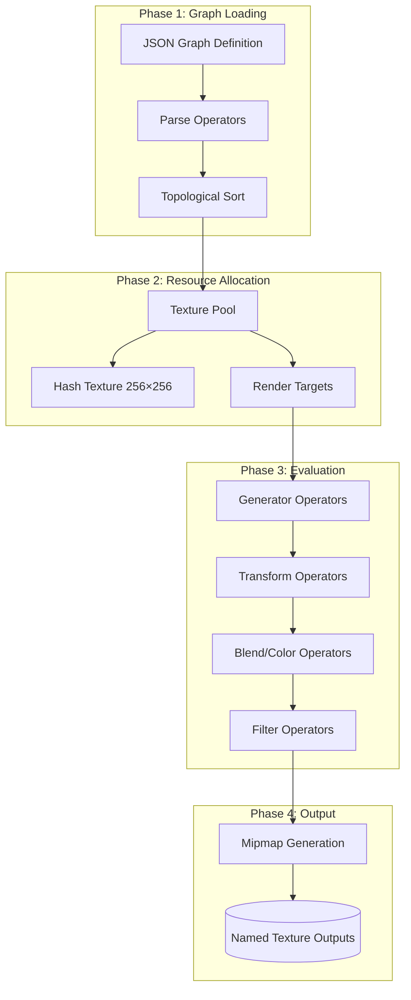

# TexGen System Porting Guide: Overview

This documentation package provides everything needed to implement the apEx/Phoenix procedural texture generation (TexGen) system in Rust + WGPU + WGSL. The TexGen system transforms compact operator graphs into full-resolution textures via GPU compute/fragment shaders.

## System Architecture



## Core Concepts

### Operator Graph (DAG)

TexGen represents procedural textures as a **Directed Acyclic Graph** of operators. Each operator:
- Has a **filter type** (noise, blur, colorize, etc.)
- Specifies its **output resolution** (power-of-two)
- References up to **3 parent operators** as inputs
- Contains **16 bytes of parameters** (normalized 0-255)
- May have a **random seed** for procedural variation

### Lazy Evaluation with Memoization

Operators evaluate **recursively** from outputs to inputs:
1. Check if result is cached → return immediately
2. Recursively evaluate all parent operators
3. Allocate render targets from pool
4. Execute filter shader (potentially multi-pass)
5. Cache result for reuse
6. Release temporary textures back to pool

### Texture Pool

A resolution/format-aware pool manages GPU textures:
- Textures are reused when resolution and HDR flag match
- `Used` flag tracks allocation state
- Intermediate results release after downstream consumers finish
- Final outputs persist for material binding

## Resource Estimates

| Resource | Count/Size | Notes |
|----------|------------|-------|
| Operator types | ~37 | Generators, transforms, filters, blends |
| WGSL shaders | ~37 | One compute/fragment shader per operator |
| Hash texture | 256×256 RGBA8 | Shared noise basis |
| Typical graph | 10-50 operators | Per-texture complexity |
| Output textures | 1-5 per graph | Named exports |

## Implementation Phases

### Phase 1: Infrastructure (Foundation)
**Goal**: Load graphs, allocate textures, dispatch single-pass operators

**Documents**: 01-data-structures.md, 03-texture-pool.md

**Deliverables**:
- [ ] JSON graph parser with validation
- [ ] Texture pool with resolution/format matching
- [ ] Hash texture generation (256×256 xorshf96)
- [ ] Compute pipeline for single-pass operators
- [ ] Topological sort for evaluation order

**Milestones**:
1. Parse any of the 36 reference JSON graphs
2. Allocate textures matching operator resolutions
3. Generate and bind hash texture
4. Execute `SolidColor` operator (trivial test case)

### Phase 2: Generators (Pattern Sources)
**Goal**: Implement all pattern-generating operators

**Documents**: 04-generators.md, shaders/noise.wgsl, shaders/cells.wgsl

**Operators**:
- `Noise` - Multi-octave Perlin (up to 8 passes)
- `Gradient` - 6 geometric patterns (radial, box, linear, etc.)
- `Cells` / `Cells2` / `CellEdges` - Voronoi variants
- `SubPlasma` - Catmull-Rom interpolated noise
- `Tiles` - Grid with brick offset
- `Rectangle` - Superellipse SDF
- `EnvMap` - Radial falloff
- `SolidColor` - Constant RGBA

**Milestones**:
1. FBM noise matches Phoenix reference (visual comparison)
2. All 6 gradient patterns produce correct output
3. Voronoi cells use correct distance metrics (Euclidean/Manhattan)

### Phase 3: Transforms & Color (Processing)
**Goal**: Implement UV transforms and color operations

**Documents**: 05-transforms.md, 06-color-blend.md

**Operators**:
- **Transforms**: Rotozoom, Translate, Mirror, Loop, Pixelize, ToPolar
- **Color**: Colorize, HSL, Scale, Contrast, Invert, Curves
- **Blend**: Combine (10 modes), Mix, MixMap, ReplaceAlpha

**Milestones**:
1. Rotozoom produces correct rotation/scale
2. All 10 blend modes match reference
3. HSL color space conversion is accurate

### Phase 4: Filters & Integration (Completion)
**Goal**: Complete operator set and PBR pipeline integration

**Documents**: 07-filters.md

**Operators**:
- `Blur` - Separable Gaussian (2-pass)
- `DirBlur` - Directional blur
- `Normalmap` - Sobel height-to-normal
- `Turbulence` - UV distortion
- `Smoothstep` - Threshold with soft edges
- `Glass` - Refraction normal generation

**Integration**:
- Bind group layout matching PBR material slots
- Texture handoff to material system
- Hot-reload support for iteration

**Milestones**:
1. Blur produces correct Gaussian falloff
2. Normal maps are tangent-space correct
3. Full "brushed-metal" graph renders correctly
4. All 36 reference graphs produce matching output

## Verification Strategy

### Visual Comparison
Reference images exist for all 36 extracted TexGen graphs. Each operator implementation should produce pixel-approximate output (accounting for float precision differences).

### Numerical Tests
For deterministic operators (Gradient, Rectangle, Tiles):
- Sample specific UV coordinates
- Verify output matches analytical formula

### Memory Profiling
The texture pool should:
- Reuse textures when possible
- Not leak allocations across graph evaluations
- Peak memory should match theoretical minimum

## Critical Source Files

| Path | Content |
|------|---------|
| `reproduction/_texgen/*.json` | 36 graph definitions |
| `extracted/shaders/annotated/texgen/*.hlsl` | HLSL reference implementations |
| `notes/per-demoscene/apex-public/texgen/operators.md` | Parameter documentation |
| `notes/per-demoscene/apex-public/texgen/pipeline.md` | Evaluation flow |
| `notes/per-demoscene/apex-public/texgen/generators.md` | Algorithm details |

## Dependency on PBR Pipeline

TexGen outputs bind to materials via the PBR pipeline's bind groups:

```
Group 2: Material Textures
  @binding(0) albedo_metalness    ← TexGen TEXTURE0 slot
  @binding(1) normal_roughness    ← TexGen TEXTURE1 slot
  @binding(2) emissive_alpha      ← TexGen TEXTURE2 slot
```

The texture pool's output handles become shader resource views in the material bind group. See `plans/rust-port-pbr/01-data-structures.md` for bind group layouts.

## Document Index

| Document | Purpose | Est. Lines |
|----------|---------|------------|
| [01-data-structures.md](01-data-structures.md) | Rust structs, enums, graph representation | ~500 |
| [02-graph-evaluation.md](02-graph-evaluation.md) | Topological sort, caching, multi-pass | ~400 |
| [03-texture-pool.md](03-texture-pool.md) | Resolution tracking, allocation, reuse | ~350 |
| [04-generators.md](04-generators.md) | Noise, Gradient, Cells, etc. with WGSL | ~600 |
| [05-transforms.md](05-transforms.md) | Rotozoom, Mirror, Polar with WGSL | ~400 |
| [06-color-blend.md](06-color-blend.md) | Colorize, Combine, HSL with WGSL | ~500 |
| [07-filters.md](07-filters.md) | Blur, Normalmap, Turbulence with WGSL | ~400 |
| [appendix/param-encoding.md](appendix/param-encoding.md) | 16-byte format, normalization | ~200 |

## Shader Index

| Shader | Lines | Category |
|--------|-------|----------|
| `shaders/common.wgsl` | ~100 | Hash sampling, UV utilities |
| `shaders/noise.wgsl` | ~150 | Multi-octave Perlin |
| `shaders/cells.wgsl` | ~120 | Voronoi distance field |
| `shaders/gradient.wgsl` | ~80 | Geometric patterns |
| `shaders/colorize.wgsl` | ~60 | Gradient mapping |
| `shaders/combine.wgsl` | ~150 | Blend modes |
| `shaders/blur.wgsl` | ~100 | Separable Gaussian |
| `shaders/normalmap.wgsl` | ~80 | Sobel operator |

## Next Steps

1. Start with [01-data-structures.md](01-data-structures.md) to define Rust types
2. Implement texture pool from [03-texture-pool.md](03-texture-pool.md)
3. Build evaluation engine from [02-graph-evaluation.md](02-graph-evaluation.md)
4. Add operators incrementally: generators → transforms → filters
5. Integrate with PBR material system
